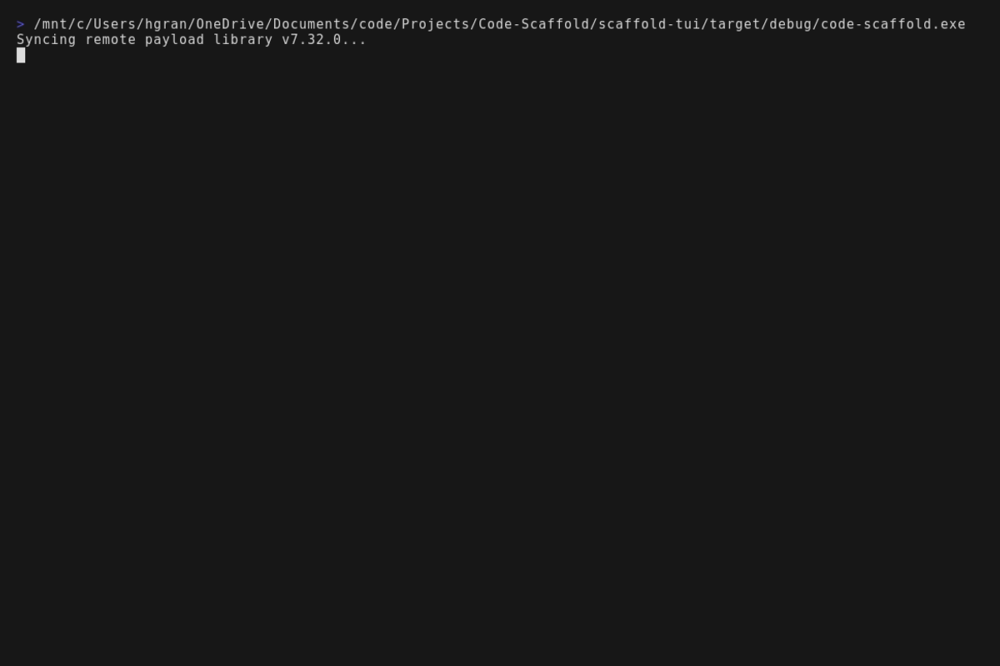
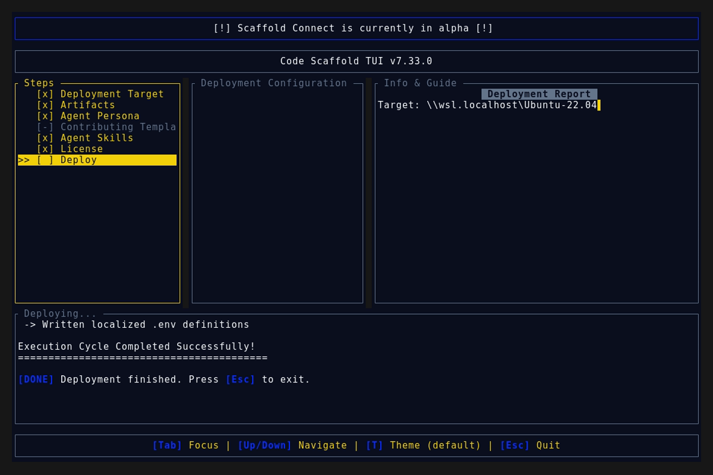
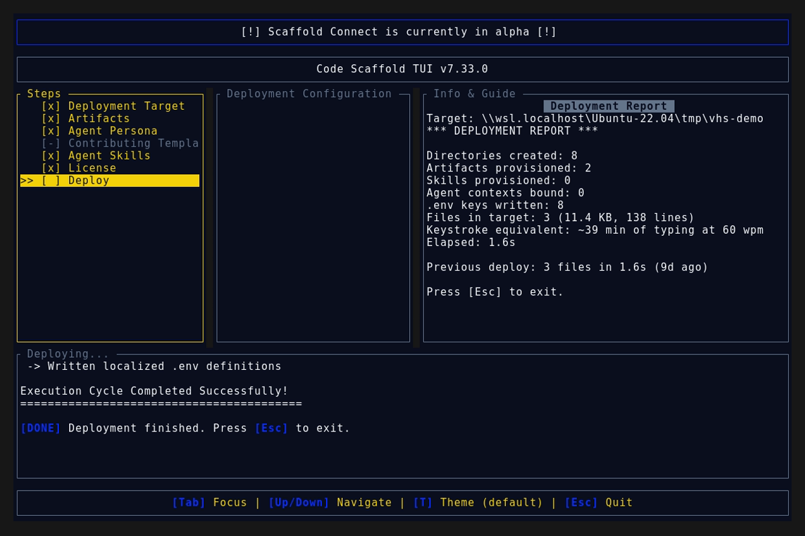

# Code Scaffold v7.33.0 Release Walkthrough

**Release Version:** `v7.33.0`

**Type:** Minor Release (+0.1.0)

**Date:** October 2026

## Overview
Code Scaffold `v7.33.0` delivers substantial feature advancements across two foundational engineering domains : Autonomous Computer-Aided Design (CAD Tools v10) and Modern Search and Generative Optimization (SEO GEO AEO Auditor v5). This release introduces automated orthographic blueprint generation, multi-process DfAM/DFM manufacturing limit checks, fastener catalog indexing, modern Core Web Vitals (INP/LCP/CLS), active Schema.org deprecation guards, 130 to 170 word passage citability scoring, and E-E-A-T search quality auditing under the Falsifiability Protocol.

---

## Visual Demonstration

### Interactive TUI Visuals

---

## Key Features and Enhancements

### 1. CAD Tools v10: Autonomous Engineering and Manufacturing Pipeline
* **Generative Design & Calibrated Alien Meter:** SIMP algorithmic topology optimization parameterizing structural compliance against biological form factors, with an analogous technical slider avoiding visual color noise.
* **Manufacturing Limits Auditor (`scripts/manufacturing_auditor.py`):** Deterministic Design for Additive Manufacturing (DfAM) and Design for Machining (DFM) verification across 4 processes : CNC 3-axis/5-axis milling, FDM 3D printing, SLA resin, and Sheet Metal fabrication.
* **Orthographic Blueprint Generator (`scripts/drawing_generator.py`):** Standalone zero-dependency SVG generator producing high-contrast engineering drawings with third-angle projection (Front, Top, Right, Isometric views), title blocks, and standard dimensional callouts.
* **Standard Fastener Vault Reference (`references/FASTENER_VAULT.md`):** Comprehensive engineering lookup for ISO metric (M2 to M16) and Unified imperial (#2-56 to 1/2"-13) threads, tap drill sizes, clearance holes, and counterbore specifications.
* **Manufacturing Tolerances Matrix (`references/MANUFACTURING_LIMITS.md`):** Complete operational guidelines detailing minimum wall thicknesses, overhang angles, unsupported bridge spans, drill depth-to-diameter ratios, and bend radii.
* **Headless FreeCAD Socket Bridge (`scripts/freecad_bridge.py`):** Bidirectional communication via JSON-RPC STDIO and REST socket for parametric geometry generation, boolean operations, and multi-format exports (.STEP, .STL, .3MF, .FCStd).

### 2. SEO GEO AEO Auditor v5: Modern Search & Agentic Web Readiness
* **Modern Core Web Vitals (2024 to 2026 Standards):** Enforces Interaction to Next Paint (INP < 200ms) as the sole responsiveness standard, permanently replacing deprecated FID. Audits Largest Contentful Paint (LCP < 2.5s with hero image preloading) and Cumulative Layout Shift (CLS < 0.1).
* **Active Schema.org Registry & Deprecation Guard (`references/SCHEMA_REGISTRY.md`):** Full multi-entity JSON-LD templates (`Organization`, `TechArticle`, `Product`, `SoftwareApplication`, `LocalBusiness`, `QAPage`) while actively flagging retired schemas like `FAQPage` and `HowTo`.
* **High-Citability Passage Architecture (`references/AI_SEARCH_PLAYBOOK.md`):** Targets the empirical 130 to 170 word sweet spot for AI search tokenizers (Google AI Overviews, Perplexity, ChatGPT Search, Gemini), optimizing claim-to-evidence density and entity disambiguation.
* **Answer Engine Optimization (AEO):** Formulates H2/H3 subheadings as natural language questions paired with immediate 30 to 60 word answer paragraphs.
* **E-E-A-T Quality & Agentic Web Readiness (`references/EEAT_FRAMEWORK.md`):** Evaluates Experience, Expertise, Authoritativeness, and Trustworthiness through the Who, How, and Why heuristic, verifying `/llms.txt` and semantic HTML landmarks.
* **Automated CLI Runner (`scripts/audit.js`):** Zero-dependency Node.js auditing tool evaluating local HTML build artifacts or live URLs, outputting composite scores, pillar breakdowns, and falsifiable remediations with leading indicator tests.

### 3. Skill Ecosystem Governance and Catalog Synchronization
* **SkillForge Compliance:** All 59 skills in `.skills/` verified 100% compliant with anatomical, schema, logo, and typography invariants.
* **Provenance Watermarking:** Cryptographic SHA-256 integrity tokens and steganographic zero-width signatures verified and updated across all manifests.
* **Registry Synchronization:** Root `.skills/README.md` updated with expanded keyword tags and version entries for CAD Tools v10 and SEO GEO AEO Auditor v5.

---

## Verification and Compliance Summary

* **SkillForge Gatekeeper Compliance:** 59 / 59 skills passed with 100% architectural compliance via `verify_skills.js`.
* **Rust Code Hygiene:** `cargo fmt --check` exited with code 0, `cargo clippy` passed with 0 warnings, and `cargo test` passed all test suites.
* **Release Media Capture:** Automated VHS headless capture via WSL generated `demo.gif` and `demo_splash.png` against the `v7.33.0` binary.
* **Typographic Invariants:** Strictly zero en/em dashes and no hyphens used as punctuation across all documentation files.
