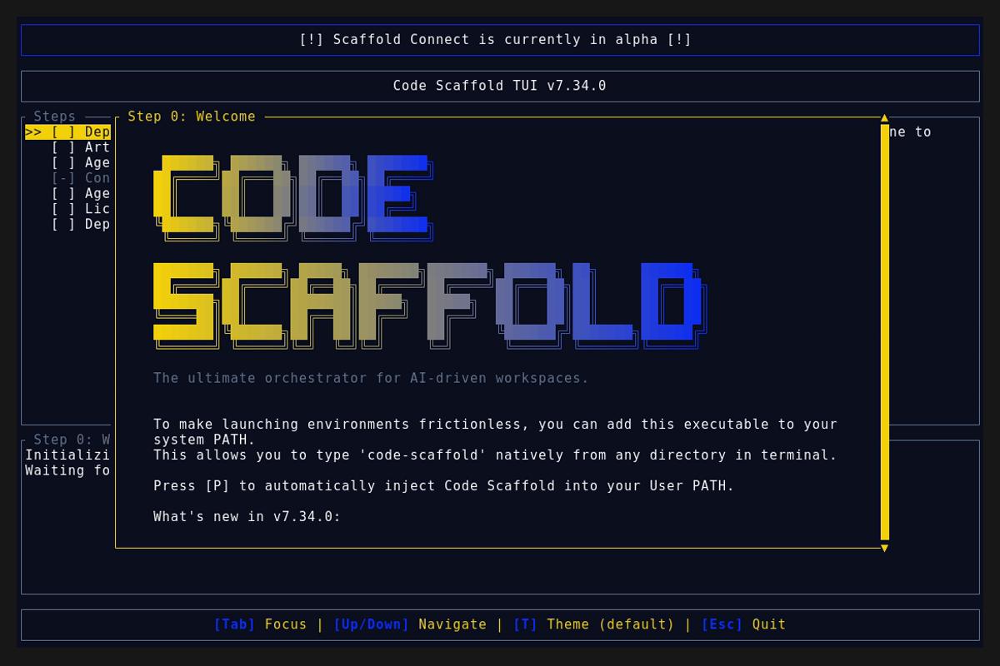
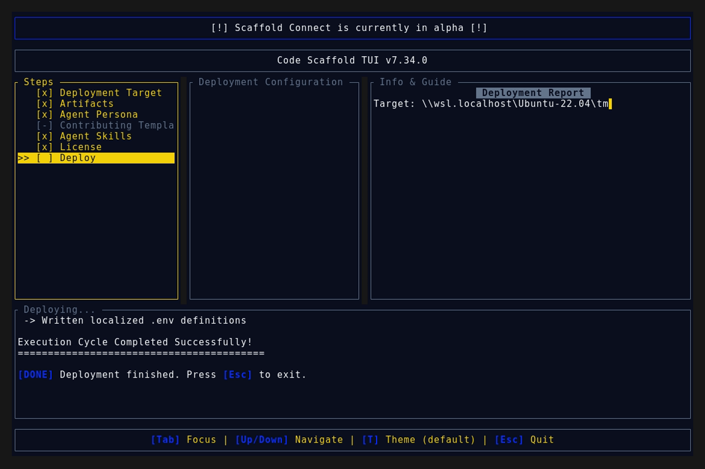
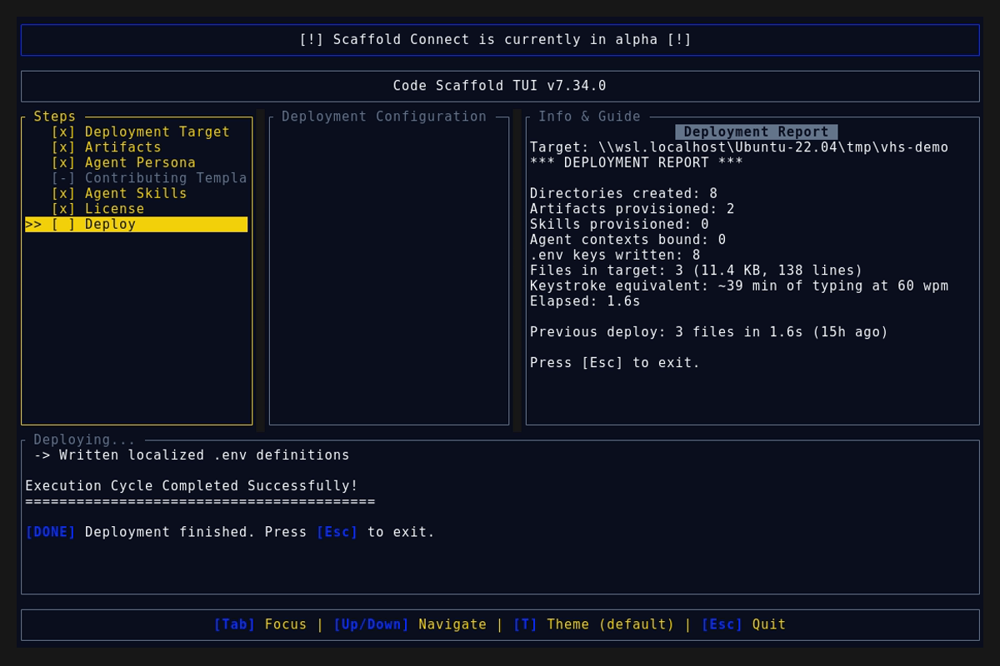

# Code Scaffold v7.34.0 Release Walkthrough

**Release Version:** `v7.34.0`

**Type:** Minor Release (+0.1.0)

**Date:** October 2026

## Overview
Code Scaffold `v7.34.0` expands the developer arsenal with the introduction of the **A2A Agent Bridge** skill (`.skills/a2a/`), bringing the total verified skills library to 60. The A2A Agent Bridge skill equips AI agents to scaffold, integrate, and validate Agent2Agent protocol servers, clients, and multi-agent meshes across six language ecosystems, facilitating discovery, negotiation, and long-running task collaboration between opaque agentic applications without compromising internal states or tool credentials.

---

## Visual Demonstration

### Interactive TUI Visuals

---

## Key Features and Enhancements

### 1. A2A Agent Bridge Skill: Universal Multi-Agent Interoperability
* **Agent Card Authoring:** Standardizes machine-readable discovery contracts served at `/.well-known/agent-card.json` containing provider identity, base service endpoints, skill capabilities, modality tags (text, file, data), authentication schemes, and supported wire interfaces.
* **Tri-Transport Bindings:** Comprehensive support for JSON-RPC 2.0 over HTTP (broadest ecosystem reach), HTTP+JSON REST (simple web-native integration), and gRPC with Protobuf (typed high-performance streaming).
* **Task Lifecycle & Persistence:** Implements stateful task lifecycle state machines (Submit, StartWork, AddArtifact, Complete, Fail, Cancel, RequireInput) with pluggable SQL persistence (PostgreSQL, MySQL, SQLite) for production workloads.
* **Streaming & Webhook Architecture:** Native Server-Sent Events (SSE) streaming for real-time incremental outputs and webhook push notifications for long-running disconnected client flows.
* **Six Language Matrix:** Full scaffolding recipes and dependency managers across Python (`a2a-sdk`), TypeScript (`@a2a-js/sdk`), Go (`a2a-go/v2`), Java 17+ (Maven `org.a2aproject.sdk`), C# / .NET 8+ (NuGet `A2A`), and Rust workspace crates (`a2a`, `a2a-client`, `a2a-server`).
* **Headless Validation Loop:** Automated verification workflows leveraging official `a2a` CLI probes, web-based protocol inspector sessions, and Technology Compatibility Kit (TCK) conformance test suites.
* **Cross-Skill Synergy:** Composes horizontally with MCP Generator (vertical tool depth) and A2UI (declarative interface rendering) to construct comprehensive agent meshes.

### 2. Skill Ecosystem Governance and Catalog Synchronization
* **SkillForge Gatekeeper Compliance:** All 60 skills in `.skills/` verified 100% compliant with anatomical, schema, logo, and typography invariants.
* **Cryptographic Provenance:** Phase 6 SHA-256 integrity tokens and zero-width steganographic signatures updated and verified across all skill manifests.
* **Registry Synchronization:** Root `.skills/README.md` updated with indexing and metadata for the A2A Agent Bridge skill.

---

## Verification and Compliance Summary

* **SkillForge Gatekeeper Compliance:** 60 / 60 skills passed with 100% architectural compliance via `verify_skills.js`.
* **Rust Code Hygiene:** `cargo fmt --check` exited with code 0, `cargo clippy` passed with 0 warnings, and `cargo test` passed all unit tests.
* **Release Media Capture:** Automated headless VHS capture via WSL generated `demo.gif` and high-fidelity TUI snapshots against the `v7.34.0` binary.
* **Typographic Invariants:** Strictly zero en/em dashes and no hyphens used as punctuation across all documentation files.
