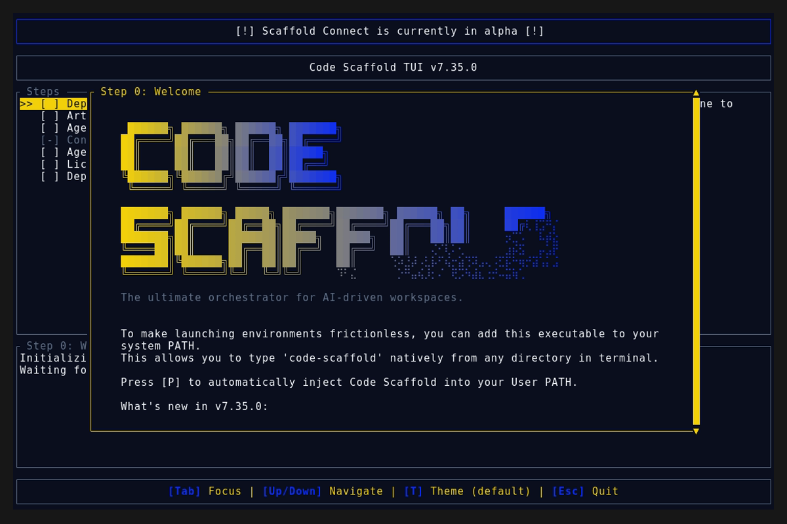
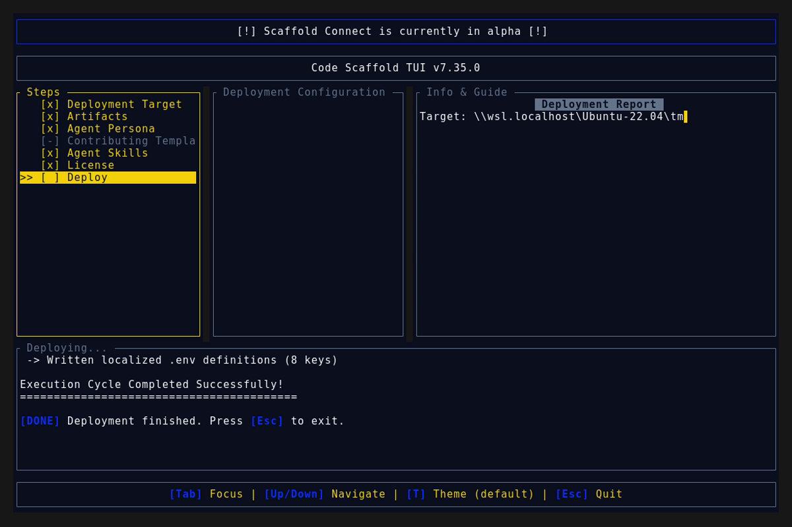
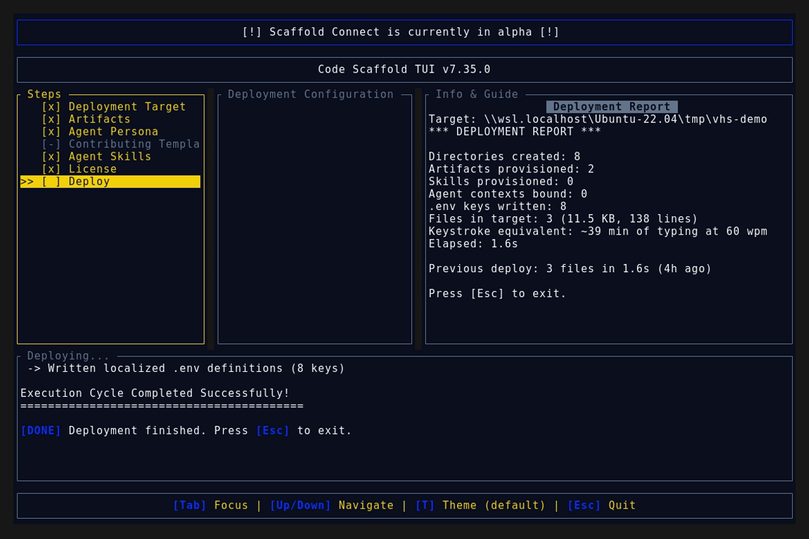

# Code Scaffold v7.35.0 Release Walkthrough

**Release Version:** `v7.35.0`

**Type:** Minor Release (+0.1.0)

**Date:** October 2026

## Overview
Code Scaffold `v7.35.0` delivers major enhancements across workspace detection accuracy, deployment metrics telemetry, artifact governance consolidation, and release history synchronization. This release unifies AI agent rules under canonical `.agents/AGENTS.md` boundaries, eliminates dual-generation placeholder file conflicts across `agent.md` and `contributing.md`, brings robust self-healing for legacy stubs, introduces universal multi-stack semver automation for Changelog Plus v4, and synchronizes the full 60-skill registry across root manifests and remote payload distribution caches.

---

## Visual Demonstration

### Interactive TUI Visuals

---

## Key Features and Enhancements

### 1. Accurate Deployment Metrics Telemetry
* **Incremental Session Tracking:** Scaffolding metrics now precisely track delta changes made during the active session. If only 1 skill is added to an existing codebase, the deployment report card reports `1 provisioned` rather than counting all previously retained skills.
* **Retained Resource Reporting:** Transparently distinguishes between freshly provisioned artifacts and retained resources (`retained` vs `provisioned`), preventing inflated numbers when re-running against existing projects.
* **Accurate Environment Variable Telemetry:** Existing keys in `.env` are protected, retained, and reported accurately without counting existing variables as newly written keys.

### 2. Unified Agent Governance and Canonical Boundaries
* **Canonical Path Enforcement:** Consolidated AI agent governance strictly under `[project root]/.agents/AGENTS.md` accompanied by universal agent symlink/stub pointers (`.cursorrules`, `.windsurfrules`, `.github/copilot-instructions.md`, `CLAUDE.md`, `GEMINI.md`).
* **Elimination of Duplicate Placeholders:** Removed legacy dual-generation paths where `Category::Artifacts` copied raw template placeholders into `project_details/agent.md`.
* **Self-Healing Legacy Cleanup:** Automatically detects and purges obsolete un-injected template placeholders in `project_details/agent.md` when provisioning `.agents/AGENTS.md`.
* **Multi-Persona Detection:** Upgraded `detect_personas` to scan across `.agents/AGENTS.md`, root `AGENT.md`/`AGENTS.md`, and legacy locations case-insensitively, supporting multi-persona selections (e.g. Mobile, Web Dev, Containerization) simultaneously.

### 3. Contributing Policy Architecture and Empty-File Self-Healing
* **Strict Ownership and Open Source Policies:** Enforced single-target deployment of contributing policies to `[project root]/CONTRIBUTING.md`.
* **Empty File Overwrite Protection:** Enhanced `manifest_engine` write and copy pipelines to distinguish between meaningful existing files and empty/placeholder files (0 bytes, whitespace-only, or dummy placeholder comments). Empty or placeholder files are now safely replaced with the chosen policy rather than being treated as retained.
* **Obsolete Placeholder Purging:** When generating `CONTRIBUTING.md`, obsolete placeholder files at `project_details/contributing.md` are automatically cleaned up.
* **Detection Resilience:** Upgraded `check_artifact_exists_on_disk` and `detect_contributing_template` to filter out empty files and placeholder comments, preventing blank files from falsely registering as active open-source templates.
* **Headless Mode Parity:** Added embedded fallback template content to headless runs, guaranteeing successful generation across all deployment modes.

### 4. Changelog Plus v4 and Universal Bump Script
* **Universal Multi-Stack Manifest Detection:** Shipped `bump_version.ps1` template supporting Node.js (`package.json`), Rust (`Cargo.toml` and `Cargo.lock`), and Python (`pyproject.toml`) synchronization.
* **User Interview Protocols:** Embedded interactive confirmation steps in the agent guidance requiring clear changelog summaries and explicit semver reasoning prior to version bumping.
* **WSL POSIX PTY Bridge:** Robust headless tape recording automation on Windows, eliminating PTY hang risks.

### 5. Ecosystem Manifest & Distribution Library Synchronization
* **Complete 60-Skill Manifest Index:** Synchronized root `manifest.json` to register all 60 skills in `.skills/`, eliminating previous gaps where modern skills were absent from the root manifest.
* **Distribution Cache Guard:** Expanded `sync.rs` payload verification to assert existence across all four payload collections (`.templates`, `.skills`, `.licenses`, `.contributions`) prior to skipping remote synchronization.
* **Flexible Version Parser:** Implemented `extract_json_version` across TUI workspace inspectors to parse both string (`"4"`) and numeric (`4`) version representations with fallback to `skill-manifest.json`.

---

## Verification and Compliance Summary

* **SkillForge Gatekeeper Compliance:** 60 / 60 skills passed with 100% architectural compliance via `verify_skills.js`.
* **Rust Code Hygiene:** `cargo fmt --check` exited with code 0, `cargo clippy` passed with 0 warnings, and `cargo test` passed all 50 unit tests.
* **Release Media Capture:** Automated headless VHS capture via WSL generated `demo.gif` and high-fidelity TUI snapshots against the `v7.35.0` binary.
* **Typographic Invariants:** Strictly zero en/em dashes and no hyphens used as punctuation across all documentation files.
