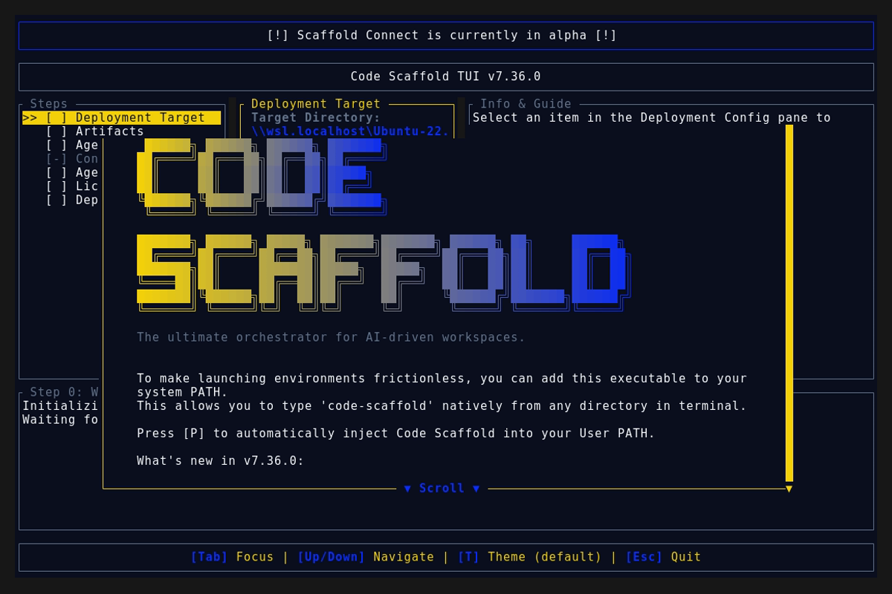
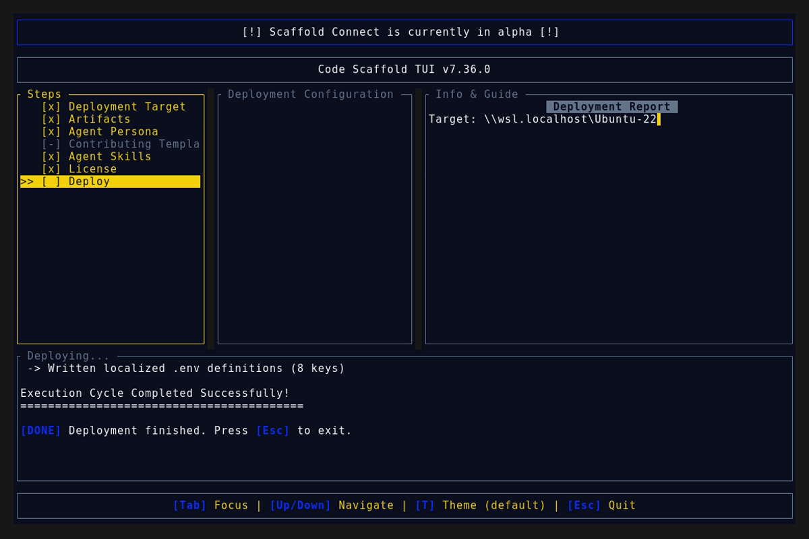
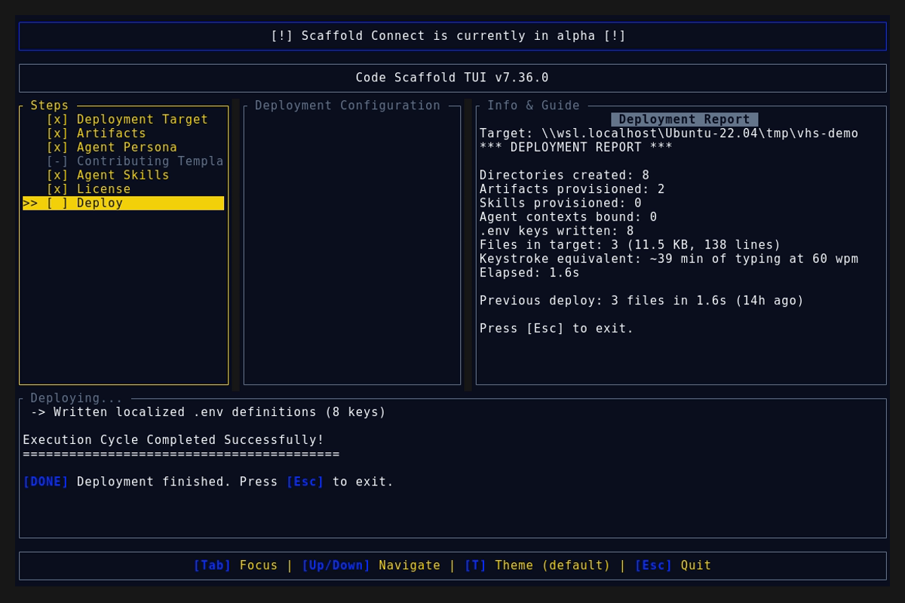

# Code Scaffold v7.36.0 Release Walkthrough

**Release Version:** `v7.36.0`

**Type:** Minor Release (+0.1.0)

**Date:** October 2026

## Overview
Code Scaffold `v7.36.0` expands the developer arsenal with **Cadence Algorithmic Audio**, a browser-native live coding music studio, pattern compiler, and stage performance workstation. Incubated under the SkillForge Protocol with 100% proprietary branding and zero brand leakage, this release introduces multi-voice Web Audio synthesis, real-time oscilloscope and spectrum telemetry, 16-step rhythm sequencers, tracker-style multi-track timeline arrangement, dynamic stage cueing protocols, live orbit soloing and muting, and TB-303 acid filter modeling.

---

## Visual Demonstration

### Interactive TUI Visuals

---

## Key Features and Enhancements

### 1. Cadence Algorithmic Audio Engine (`.skills/cadence`)
* **Proprietary Live Coding Architecture:** Complete algorithmic music engine translating expressive pattern mini-notation into real-time Web Audio compositions without external servers or native runtimes.
* **Full SkillForge 5-File Anatomy:** Ships with `SKILL.md`, `meta.json`, `skill-manifest.json`, `readme.md`, and interactive `sandbox/index.html`.
* **Cryptographic Provenance Watermarking:** Includes deterministic integrity token `cs:sha256:f6a94fcc1a7e4d72e839fee0f3aeae8cd624d0b111200249e50fac527da4c6cc` and steganographic zero-width fingerprint.

### 2. Interactive Web Audio Live Studio (`sandbox/index.html`)
* **Multi-Voice Web Audio Synthesis:** Zero-latency sound generation featuring pitch-swept 808 sub-kicks, dual-layer noise crack snares, metallic hi-hats, multi-burst claps, and resonant acid bass oscillators.
* **Audio-Reactive Telemetry:** Dual real-time HTML5 canvas visualizers rendering live oscilloscope waveforms and 512-bin FFT frequency spectrum bars.
* **16-Step Cycle Pulse Matrix:** Glowing step sequencer dynamically tracking playback position across the cycle clock.
* **Live Pattern Code Editor:** Instant hot evaluation (`Ctrl+Enter` / `Cmd+Enter`), cycle counter, and curated genre presets (Breakbeat, Acid Techno, Tracker Arranger, Trance Gate, Deep Ambient, Euclidean Polyrhythm, Lo-Fi Chill).
* **Manual Jam Soundboard:** Low-latency trigger pads with hardware keyboard shortcuts (`Q`, `W`, `E`, `A`, `S`, `D`).

### 3. Advanced Performance Macros & Tracker Arranger
* **Tracker Multi-Track Arranger (`track` & `ar`):** Timeline-based matrix sequencing for arranging multi-stem instrument layers over cycle blocks with step masks and custom modifier hooks.
* **Dynamic Stage Cueing (`.cue`, `.oncue`, `setCue`):** Global scene tagging allowing performers to switch seamlessly between Intro, Verse, Drop, and Breakdown sections during live sets.
* **Live Orbit Soloing & Muting (`.o`, `solo`, `mute`):** Independent channel routing for instant stem isolation and tension builds.
* **Acid 303 Resonance & Accents (`acidenv`, `accent`, `rlpf`):** Resonant filter envelope modeling with velocity-coupled snap.
* **Algorithmic Trance Gating (`tgate`, `fill`):** Rhythmic chopping for sustained pads and leads with pseudo-random seed tables and legato gap-filling.
* **Pitch Scale Quantizer (`.grab`):** Snaps arbitrary note streams to targeted chords or modal scales.

### 4. Ecosystem & Manifest Registry Synchronization
* **Ecosystem Indexing:** Registered under `Audio & Creative Media` in `/.skills/README.md`.
* **Manifest Synchronization:** Added `cadence` to root `manifest.json` under `skills`, expanding the total catalog to 61 skills.
* **SkillForge Gatekeeper:** 61 / 61 skills validated with 100% architectural compliance via `verify_skills.js`.

---

## Verification and Compliance Summary

* **SkillForge Compliance:** All 61 skills passed `verify_skills.js` with zero errors.
* **Rust Code Hygiene:** `cargo fmt --check` exited with code 0, `cargo clippy` passed with 0 warnings, and `cargo test` passed all 50 unit tests.
* **Release Media Capture:** Automated headless VHS capture via WSL generated `demo.gif` and high-fidelity TUI snapshots against the `v7.36.0` binary.
* **Typographic Invariants:** Strictly zero en/em dashes and no hyphens used as punctuation across all documentation files.
