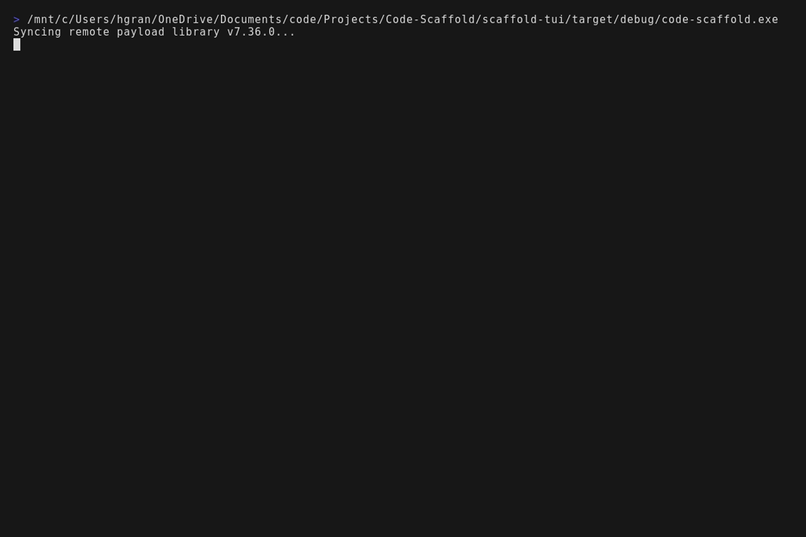
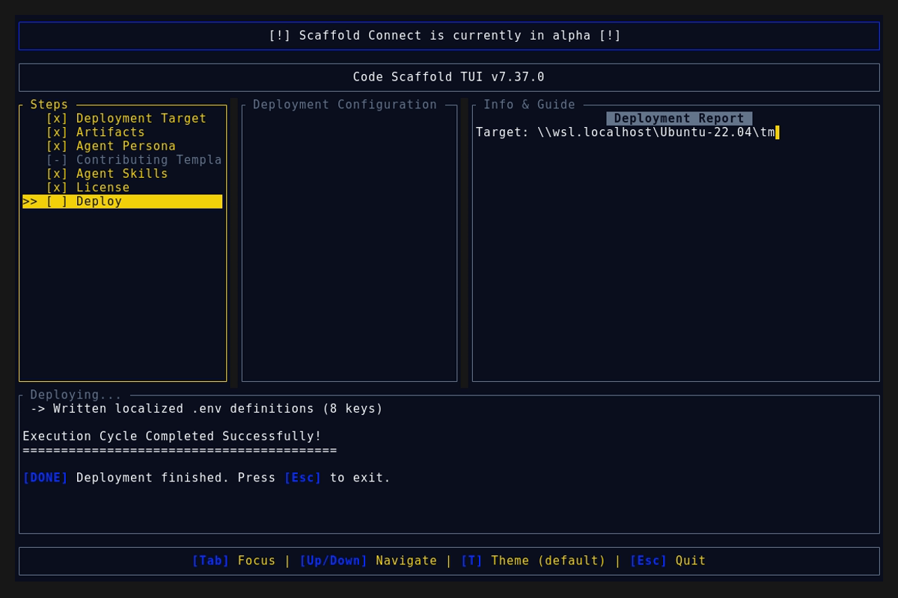
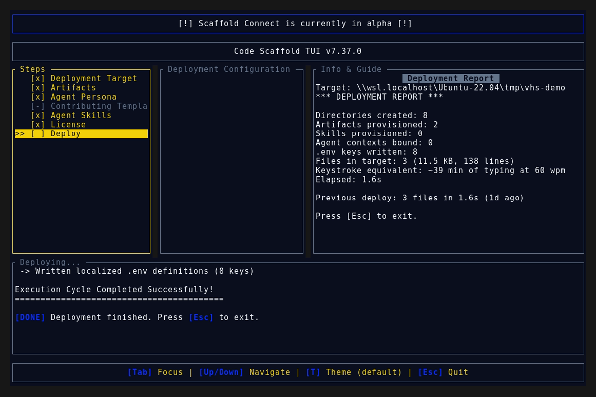

# Code Scaffold v7.37.0 Release Walkthrough

**Release Version:** `v7.37.0`

**Type:** Minor Release (+0.1.0)

**Date:** October 2026

## Overview
Code Scaffold `v7.37.0` introduces two enterprise agentic capabilities to the Code Scaffold skill registry: the **Decipher Reverse Engineer Arsenal**, a multi-target binary deconstruction pipeline, evidence obligation ledger, and clean-room reconstruction engine, and **Mechanica Physical Metaphors**, an isometric machine metaphor engine and kinematic cutaway illustrator. Both skills are built under the SkillForge Protocol featuring full 5-file anatomies, whole-number versioning, strict 6-line ANSI Shadow branding, cryptographic provenance tokens, and zero external brand leakage.

---

## Visual Demonstration

### Interactive TUI Visuals

---

## Key Features and Enhancements

### 1. Decipher Reverse Engineer Arsenal (`.skills/decipher`)
* **Multi-Target Binary Introspection:** Disassembles and decompiles native Mach-O, ELF, and Portable Executable (PE) binaries across x86, x64, and ARM64 architectures with automated symbol demangling, function boundary detection, and cross-reference analysis.
* **Desktop and Web Bundle Deobfuscation:** Unpacks Electron ASAR archives, traverses complex AST hierarchies, recovers unminified module definitions from Webpack, Vite, and Rollup bundles, and correlates sourcemap symbols.
* **Mobile Application Package Inspection:** Extracts and audits Android APK and AAB packages, decompiles Dalvik bytecode to structured Java or Kotlin representations, inspects iOS bundles, and disassembles Flutter Dart AOT snapshots.
* **Managed Runtime and Bytecode Deconstruction:** Decompiles .NET assemblies and NativeAOT binaries to CIL or C#, extracts Go PCLNTAB runtime structures and function tables, disassembles WebAssembly binaries into WAT instructions, and decodes EVM contract bytecode.
* **Evidence-Based Reconstruction Obligation Ledger:** Tracks behavioral observations into authenticated SHA-256 evidence records, compiling deterministic parity claims across positive, negative, and malformed test cases before feature closure.
* **Dynamic Runtime Observation and Hooking:** Inspects live process memory, intercepts system calls and API invocations via scriptable instrumentation hooks, and captures structured network telemetry without binary modification.
* **Clean-Room Code Synthesis:** Synthesizes production-ready, copyright-clean TypeScript or Rust implementations derived strictly from verifiable behavioral specifications and functional contracts.
* **Executive Reverse Engineering Reporting (`generate_report.mjs`):** Compiles comprehensive action summaries detailing validated findings, analysis blockers, open items of concern, and recommended next steps, complete with embedded metadata, Dublin Core headers, steganographic watermarks, and cryptographic provenance anchors.
* **Interactive Visual Studio Sandbox (`sandbox/index.html`):** Dual-pane disassembly and decompiler AST view, interactive call graph visualizer, and dynamic audit report modal with light and dark themes.
* **SEO, GEO & Discovery Optimization:** High-visibility trigger coverage across `SKILL.md`, `meta.json`, `skill-manifest.json`, and registry index, achieving top ranking (#1, score 69.0) in `code-scaffold skills search "reverse engineer"`.

### 2. Mechanica Physical Metaphors & Kinematic Illustrator (`.skills/mechanica`)
* **Physical Machine Metaphor Engine:** Translates complex abstract software architectures into intuitive physical machinery, gear trains, valves, flywheels, and hydraulic assemblies.
* **Kinematic Cutaway Illustration:** Standardized 30-degree isometric projection guidelines, four-tone technical shading palette, and exploded part assemblies for hardware explanation.
* **Interactive Visual Studio Sandbox (`sandbox/index.html`):** Interactive exploded parts slider, gear train ratio simulator, and SVG/PNG vector blueprint export.

### 3. Ecosystem & Manifest Registry Synchronization
* **Ecosystem Indexing:** Registered `Decipher Reverse Engineer Arsenal` under `### Security & Cryptography` and `Mechanica Physical Metaphors` under `### Animation & Graphics` in `/.skills/README.md`.
* **Manifest Synchronization:** Added `decipher` and `mechanica` to root `manifest.json` under `skills`, expanding the total catalog to 63 skills.
* **Search and Discovery:** Both skills fully discoverable and installable ad-hoc via `code-scaffold skills search` and `code-scaffold skills install`.

---

## Verification and Compliance Summary

* **SkillForge Compliance:** All 63 skills passed `verify_skills.js` with zero errors.
* **Rust Code Hygiene:** `cargo fmt --check` exited with code 0, `cargo clippy` passed with 0 warnings, and `cargo test` passed all 50 unit tests.
* **Release Media Capture:** Automated headless VHS capture via WSL generated `demo.gif` and high-fidelity TUI snapshots against the `v7.37.0` binary.
* **Typographic Invariants:** Strictly zero en/em dashes and no hyphens used as punctuation across all documentation files.
