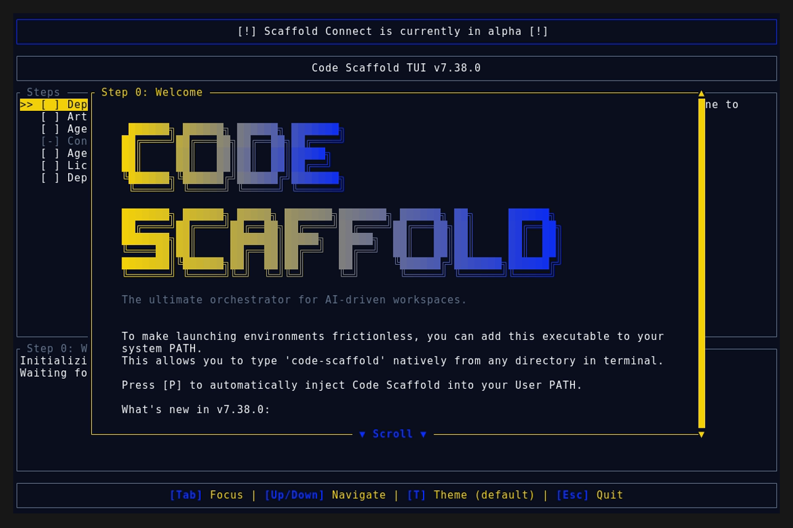
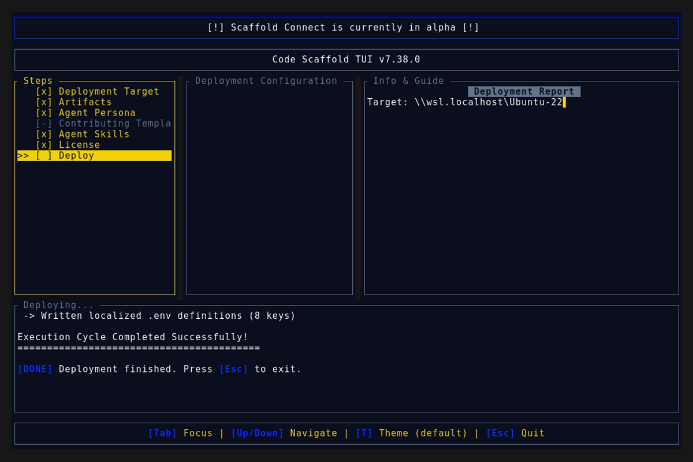
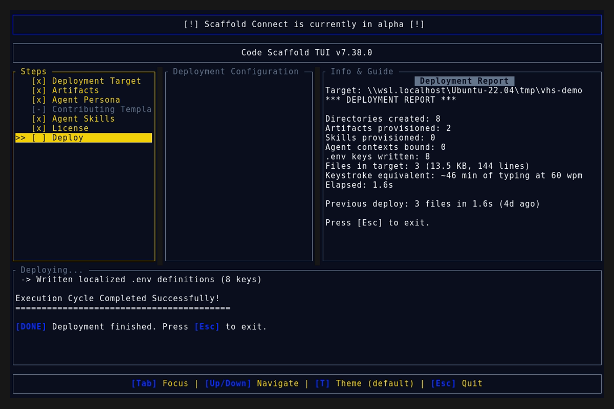

# Code Scaffold v7.38.0 Release Walkthrough

**Release Version:** `v7.38.0`

**Type:** Minor Release (+0.1.0)

**Date:** October 2026

## Overview
Code Scaffold `v7.38.0` expands the agent persona matrix with 9 new specialized personas engineered for physical sciences, engineering, and academic research workflows. The catalog has been restructured into a predictable, flat mono list with `Generic` anchored at index 0 followed by 20 specialized personas in strict alphabetical order. Additionally, this release implements intelligent companion skill auto-selection, regex and token-based round-trip persona detection, and formal Verification & Validation (V&V) architecture specifications in `project_details/testing_design.md`.

---

## Visual Demonstration

### Interactive TUI Visuals

---

## Key Features and Enhancements

### 1. Expanded Agent Persona Catalog
Introduced 9 new domain-specific agent personas engineered to interface directly with physical, numerical, spatial, and mechanical tools:
* **Academic / Research**: Enforces strict citation integrity (BibTeX/LaTeX), structured hypothesis tracking, reproducible research methodology, PRISMA review standards, and document compilation via Quarto and Pandoc.
* **AEC / BIM & Parametric**: Automates building information modeling (BIM), IFC data extraction (IfcOpenShell), structural load scripts, spatial daylight/thermal analysis, and parametric geometry.
* **CAD & Mech Engineering**: Emphasizes parametric 3D CAD modeling (OpenSCAD, CadQuery, FreeCAD), GD&T (Geometric Dimensioning & Tolerancing), tolerance stack-up analysis, bill of materials (BOM) generation, and design for manufacturing (DFM) verification.
* **Computational Science**: Focuses on numerical stability, floating-point precision bounds, SI unit consistency, ordinary and partial differential equations, and scientific modeling with NumPy/SciPy, SymPy, Julia, and R.
* **EDA & Hardware (HDL)**: Focuses on digital and analog circuit design, HDL synthesis and verification (Verilog, VHDL), KiCad PCB layout scripting, SPICE simulation, and register-transfer level (RTL) timing closure.
* **GIS & Spatial Systems**: Handles coordinate reference systems (CRS), geospatial data pipelines (GDAL, PostGIS, GeoJSON, Shapely), LiDAR point clouds, and spatial indexing.
* **Quant & Econometrics**: Prioritizes financial risk modeling, time-series analysis, algorithmic backtesting rigor, look-ahead bias prevention, and Monte Carlo simulation with quantitative libraries.
* **Robotics & Controls**: Enforces real-time loop constraints, kinematics and dynamics, sensor fusion (Kalman filters), URDF/SDF modeling, Gazebo simulation, and robot operating systems (ROS2).
* **Simulation (FEA/CFD)**: Manages finite element analysis (FEA) and computational fluid dynamics (CFD) workflows, mesh generation (Gmsh), boundary condition setup, convergence verification, and thermal/structural post-processing.

### 2. Predictable Alphabetical Layout (Mono List)
* Refactored the persona checklist in the TUI wizard into a single, predictable mono list.
* Anchored `Generic` at index 0 as the versatile general-purpose default.
* Sorted the 20 specialized personas in strict alphabetical order from `Academic / Research` to `Web Dev`.
* Preserved seamless Ratatui `ListState` keyboard navigation, right-pane live description previews, and consistent multi-select state management.

### 3. Intelligent Companion Skill Auto-Selection
* Automatically selects companion skills tailored to the newly selected persona:
  * `Academic / Research` : `quarto`, `marp`, `mermaid`
  * `AEC / BIM & Parametric` : `cad-tools`
  * `CAD & Mech Engineering` : `cad-tools`, `mechanica`
  * `Computational Science` : `quarto`, `manim`
  * `EDA & Hardware (HDL)` : `mechanica`
  * `GIS & Spatial Systems` : `tldraw`
  * `Quant & Econometrics` : `trackio`, `quarto`
  * `Robotics & Controls` : `cad-tools`, `mechanica`
  * `Simulation (FEA/CFD)` : `cad-tools`, `manim`

### 4. Round-Trip Persona Detection
* Enhanced `detect_personas()` with robust domain token and keyword matching.
* Ensures previously scaffolded projects with custom persona selections are accurately recognized and highlighted upon re-launching the wizard or applying updates.

### 5. Verification & Validation (V&V) Architectural Guidelines
* Extended `project_details/testing_design.md` with explicit quality gates for non-software domains.
* Specified mesh independence verification (grid convergence index), conservation of mass/energy checks, parametric CAD tolerance stack intervals, and hardware-in-the-loop (HIL) safety asserts.

---

## Verification and Compliance Summary

* **SkillForge Compliance:** All 66 skills in the registry pass `verify_skills.js` with zero errors.
* **Rust Code Hygiene:** `cargo fmt --check` exited with code 0, `cargo clippy` passed with 0 warnings, and `cargo test` passed all 54 unit tests.
* **Release Media Capture:** Automated headless VHS capture via WSL generated `demo.gif` and high-fidelity TUI snapshots against the `v7.38.0` binary.
* **Typographic Invariants:** Strictly zero en/em dashes and no hyphens used as punctuation across all documentation files.
