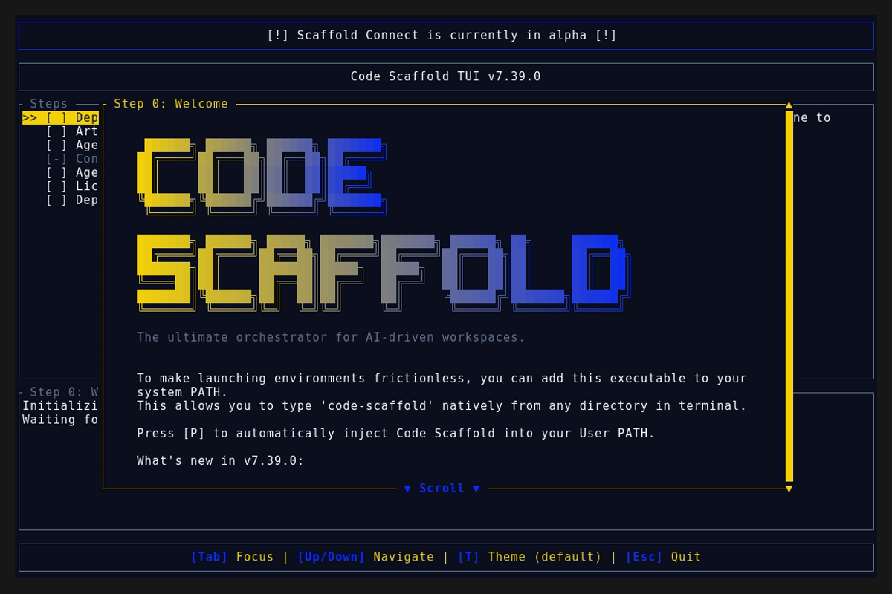
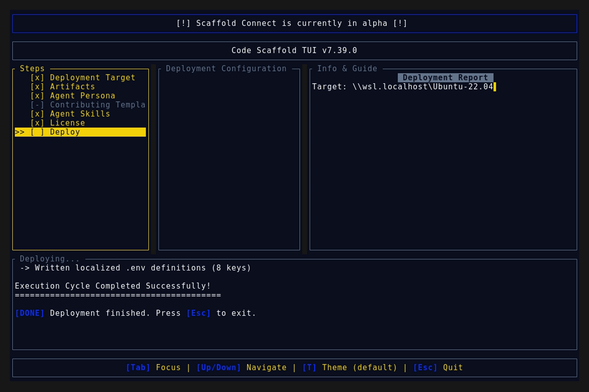
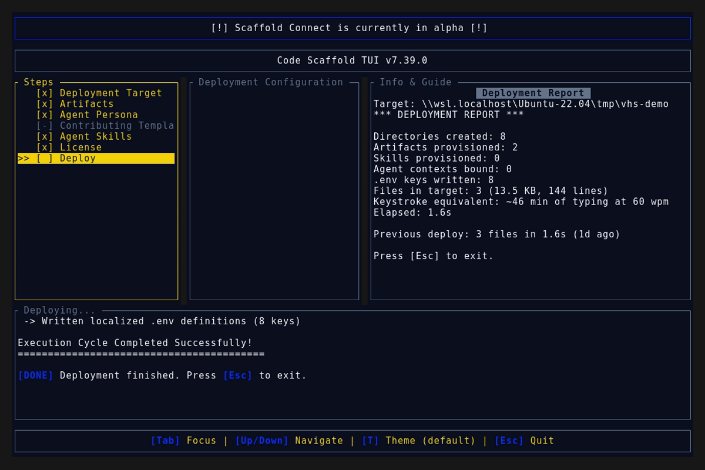

# Code Scaffold v7.39.0 Release Walkthrough

**Release Version:** `v7.39.0`

**Type:** Minor Release (+0.1.0)

**Date:** October 2026

## Overview
Code Scaffold `v7.39.0` introduces structured YAML based GitHub Issue Forms intake governance, Definition of Ready (DoR) triage gatekeeping, comprehensive mobile cross-platform support across iOS and Android, and compact `★ Rec` recommended baseline indicators within the TUI provisioning wizard.

---

## Visual Demonstration

### Interactive TUI Visuals

---

## Key Features and Enhancements

### 1. Structured GitHub Issue Forms & Intake Governance
* Replaced standard open-ended Markdown templates with YAML based GitHub Issue Forms located at `.github/ISSUE_TEMPLATE/`.
* Implemented `.github/ISSUE_TEMPLATE/bug_report.yml` requiring sequential reproduction steps, expected versus actual behavior, diagnostic terminal logs rendered as shell blocks, and intake verification checkboxes.
* Implemented `.github/ISSUE_TEMPLATE/feature_request.yml` enforcing problem statements, concrete scope boundaries, and verifiable acceptance criteria checklists.
* Implemented `.github/ISSUE_TEMPLATE/config.yml` disabling unstructured blank issues while cleanly routing community questions to GitHub Discussions.
* Enforced Definition of Ready (DoR) gatekeeping by applying initial `needs-triage` labels and requiring strict acceptance checklists before engineering work begins.
* Automated issue triage via `.github/workflows/issue-triage.yml` utilizing `actions/github-script` to tag newly opened issues immediately upon submission.

### 2. Comprehensive Mobile Platform Support (iOS & Android)
* Expanded target runtime options in the structured bug report form to include `iOS (Simulator / Physical Device)` and `Android (Emulator / Physical Device)` alongside Windows, Linux, and macOS platforms.
* Added automated Android CI pipeline blueprint (`.github/workflows/android.yml`) featuring Eclipse Temurin JDK 17, Gradle build caching, lint checks, unit tests, and debug APK artifact assembly.
* Added automated iOS CI pipeline blueprint (`.github/workflows/ios.yml`) targeting macOS runners with Xcode toolchain selection, Swift Package Manager dependency resolution, iOS Simulator unit/UI test execution, and application archive compilation.
* Bumped GitHub skill to version 8 across all manifests, sandboxes, and documentation.

### 3. Compact `★ Rec` Recommended Badges in TUI
* Integrated compact `★ Rec` visual badges into the TUI deployment configuration list to anchor developers toward recommended baseline modules.
* Formatted `★ Rec` with `theme.accent` and bold typography during idle inspection, seamlessly transitioning to high-contrast cursor styling when highlighted.
* Tagged universal baselines across project artifacts (`.gitignore`, `readme.md`, `agent.md`) and agent skills (`github`, `changelog-plus`).
* Added `.gitignore` to initial default artifact selections in `Workspace::new()` alongside `readme.md` and `agent.md`.
* Preserved opt-in autonomy by keeping recommended skills unchecked (`[ ]`) by default while guiding attention with the `★ Rec` indicator.
* Enhanced the Description Pane with dedicated status badges: `★ Recommended Foundation` for skills and `★ Recommended Baseline` for artifacts.
* Implemented `WorkspaceItem::is_recommended()` query method with dedicated unit test coverage (`55/55` tests passing).

---

## Verification and Compliance Summary

* **SkillForge Compliance:** All 66 skills in the registry pass `verify_skills.js` with zero errors.
* **Rust Code Hygiene:** `cargo fmt --check` exited with code 0, `cargo clippy` passed with 0 warnings, and `cargo test` passed all 55 unit tests.
* **Release Media Capture:** Automated headless VHS capture via WSL generated `demo.gif` and high-fidelity TUI snapshots against the `v7.39.0` binary.
* **Typographic Invariants:** Strictly zero en/em dashes and no hyphens used as punctuation across all documentation files.
