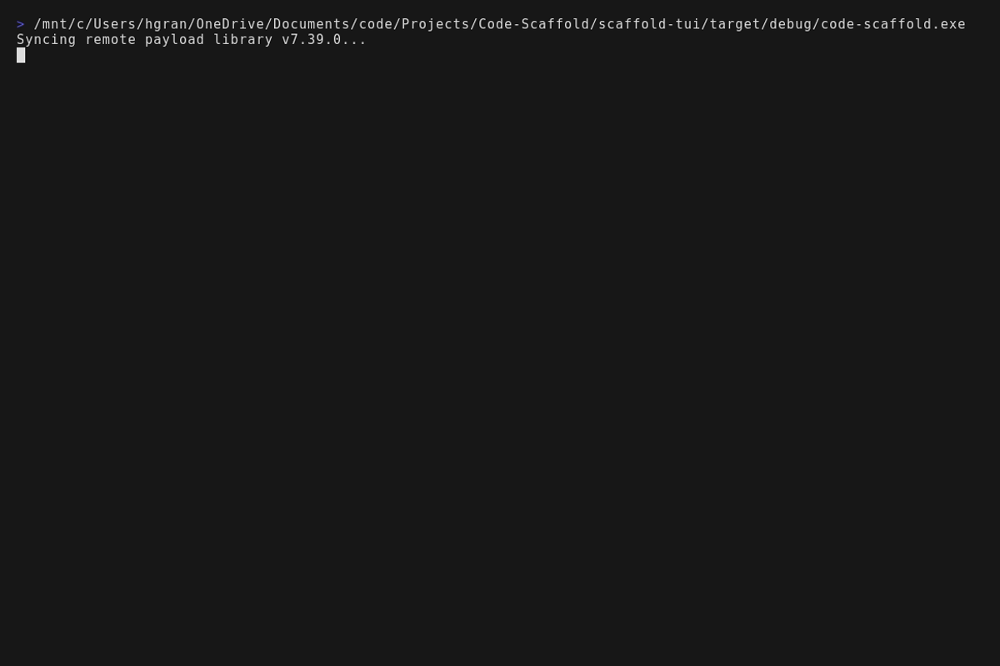
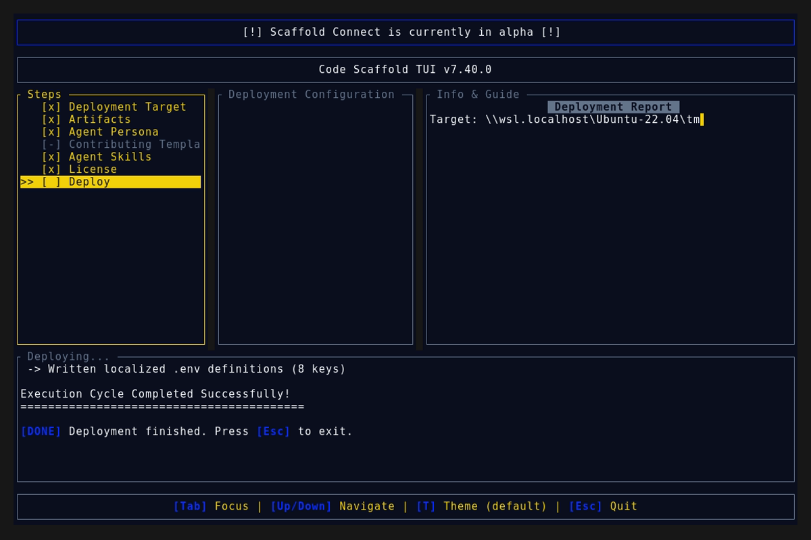
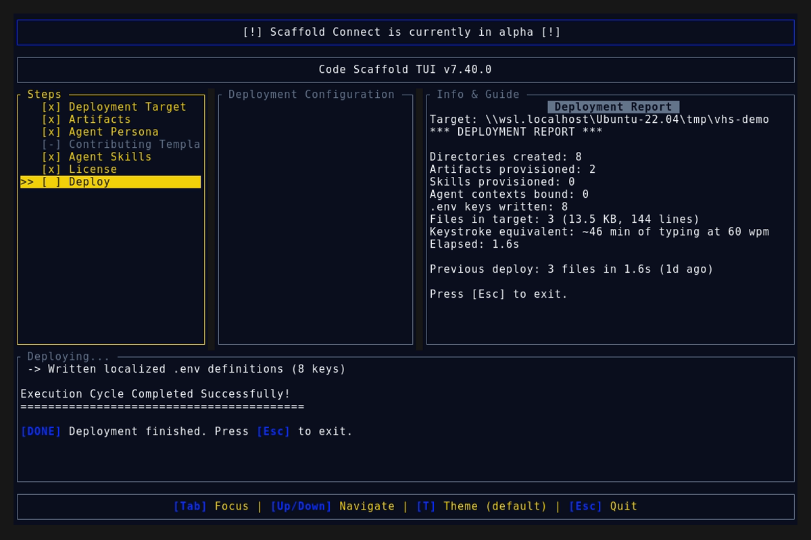

# Code Scaffold v7.40.0 Release Walkthrough

**Release Version:** `v7.40.0`

**Type:** Minor Release (+0.1.0)

**Date:** October 2026

## Overview
Code Scaffold `v7.40.0` introduces the **MXC Policy Containment Engine** skill (`.skills/mxc`), providing robust policy-driven execution sandboxing and container isolation for autonomous AI agents, dynamic model-generated code, and untrusted tools. This release establishes a default-deny operating system boundary across Windows ProcessContainers, Linux Bubblewrap, and macOS Seatbelt, externalizing authorization outside the LLM context to prevent prompt injection and credential harvesting.

---

## Visual Demonstration

### Interactive TUI Visuals

---

## Key Features and Enhancements

### 1. MXC Policy Containment Engine Skill (`.skills/mxc`)
* **Default-Deny OS Perimeter**: Shifts security authorization away from prompt-level guardrails to kernel-enforced isolation primitives, eliminating prompt injection risks and ambient authority leakage.
* **Three Enforcement Vectors**:
  * **Filesystem**: Strict partition of read-only source directories, temporary read-write scratch paths, and prioritized denied paths protecting SSH keys, cloud profiles, and environment secrets.
  * **Network Egress**: Airgapped default-deny socket filtering with whitelisted domain/port endpoints and corporate proxy routing.
  * **UI and Desktop**: Eliminates graphical window rendering, screen focus hijacking, and clipboard leakage.
* **Multi-Platform Containment Routing**:
  * **Windows**: `ProcessContainer` (AppContainer SIDs, Job Objects), `WSLc`, and Hyperlight microVMs.
  * **Linux**: `Bubblewrap` (`bwrap` unprivileged namespaces, seccomp-bpf filters) and `LXC`.
  * **macOS**: Apple `Seatbelt` (`sandbox-exec` SBPL profiles).
* **CLI Lifecycle Management**: Full command-line reference for `wxc-exec.exe` supporting ephemeral one-shot execution, state-aware multi-step lifecycles (`provision` : `start` : `exec` : `stop` : `deprovision`), structured JSON audit logging, and diagnostic modes.
* **Interactive Sandbox Studio**: Interactive web dashboard at `.skills/mxc/sandbox/index.html` featuring a dynamic Policy Studio, threat simulation matrix (prompt injection secret harvesting, network exfiltration, binary tampering), and real-time kernel audit stream.

### 2. TUI Persona Integration
* Updated the `Security Analyst` persona in `scaffold-tui/src/components/workspace.rs` to automatically pre-select `mxc` alongside `sentinel-strike`, `ghostimprint`, and `cybersecurity-toolkit`.

### 3. Registry Indexing & Discovery
* Registered `MXC Policy Containment` under `### Security & Cryptography` in `.skills/README.md`.
* Provided distribution manifest `skill-manifest.json` supporting ad-hoc CLI installation via `code-scaffold skills install mxc`.

---

## Verification and Compliance Summary

* **SkillForge Compliance:** All 67 skills in the registry pass `verify_skills.js` with zero errors.
* **Rust Code Hygiene:** `cargo fmt --check` exited with code 0, `cargo clippy` passed with 0 warnings, and `cargo test` passed all 55 unit tests.
* **Release Media Capture:** Automated headless VHS capture via WSL generated `demo.gif` and high-fidelity TUI snapshots against the `v7.40.0` binary.
* **Typographic Invariants:** Strictly zero en/em dashes and no hyphens used as punctuation across all documentation files.
