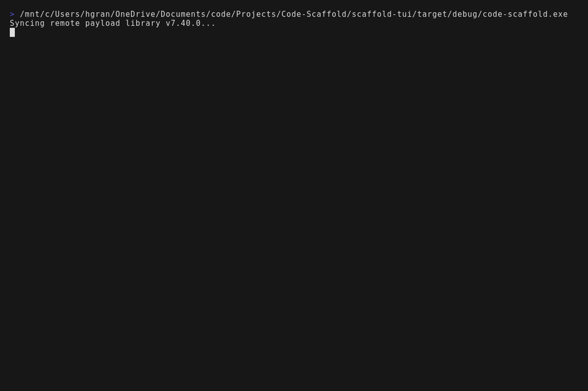
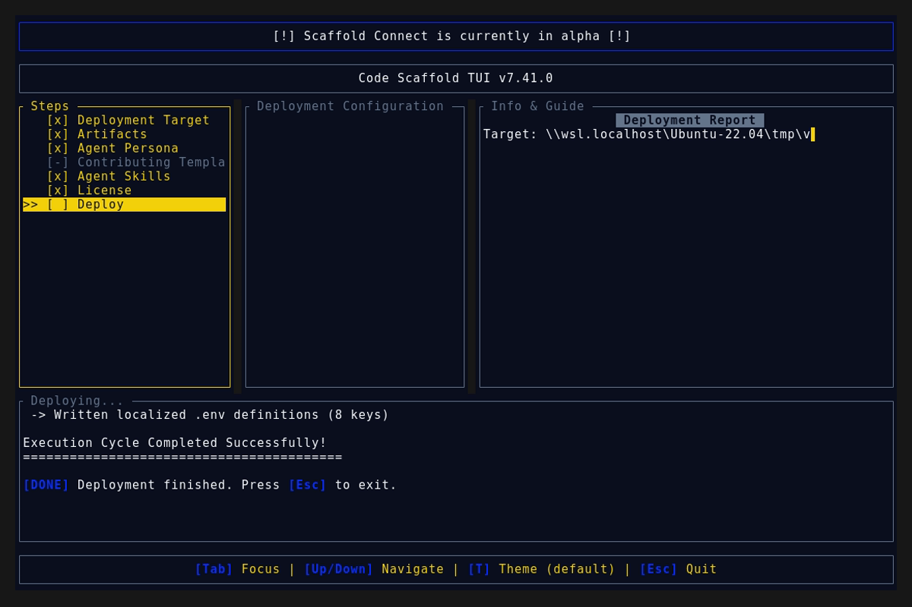
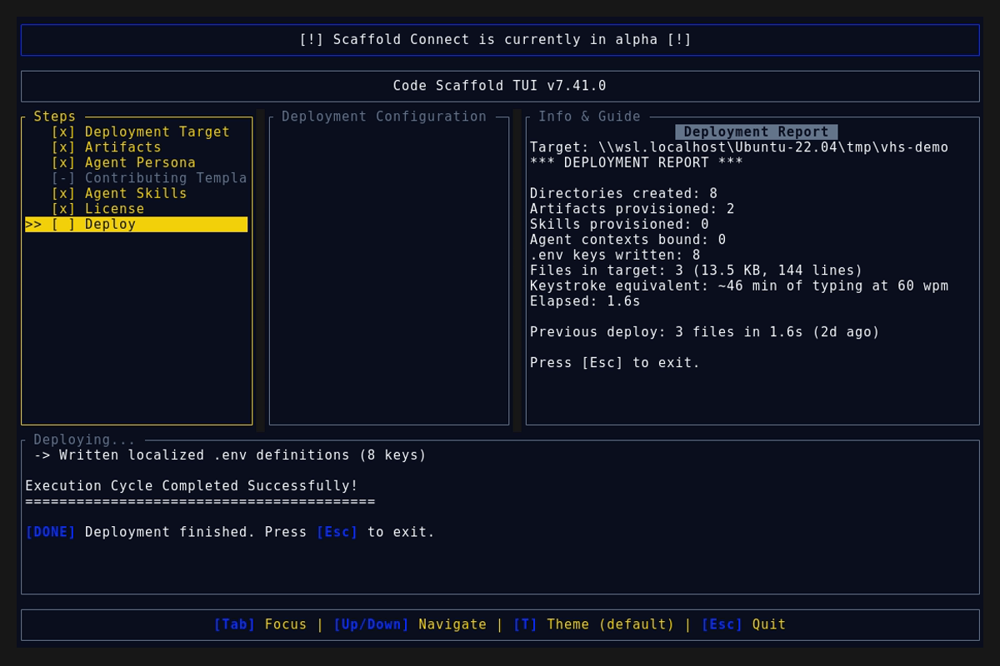

# Code Scaffold v7.41.0 Release Walkthrough

**Release Version:** `v7.41.0`

**Type:** Minor Release (+0.1.0)

**Date:** October 2026

## Overview
Code Scaffold `v7.41.0` introduces the **Open Weight Warden** skill (`.skills/open-weight-warden`), a comprehensive model integrity evaluation, binary validation, and behavioral auditing framework for open weight LLMs. This release provides static binary inspection against memory corruption deserialization exploits, non-evaluating Jinja2 AST template sanitization against remote code execution, dynamic canary honeytoken behavioral fuzzing, sleeper agent trigger discovery, and automated pairing with MXC policy containment.

---

## Visual Demonstration


### Interactive TUI Visuals




---

## Key Features and Enhancements

### 1. Open Weight Warden Skill (`.skills/open-weight-warden`)
* **Dual-Vector Inspection Architecture**: Combines static binary header validation with AST template sanitization and dynamic behavioral fuzzing to audit unverified model weights before deployment.
* **GGUF Binary Safety & Bleeding Llama Defense (CVE-2026-7482)**:
  * Validates GGUF magic bytes (`0x46554747`), specification versions (v2 and v3), and metadata key-value allocation limits to prevent buffer overflows (CVE-2024-23496).
  * Computes strict tensor boundary offsets and byte size bounds to neutralize out-of-bounds heap read vulnerabilities during quantization deserialization.
  * Verifies Safetensors header sizes and strictly blocks legacy PyTorch pickle checkpoints (`.pt`, `.bin`) carrying arbitrary code execution payloads.
* **Jinja2 Chat Template AST Sanitizer (CVE-2024-34359 / CVE-2026-5760)**:
  * Parses `tokenizer.chat_template` into an Abstract Syntax Tree without runtime execution.
  * Identifies and blocks Python dunder traversals, MRO object lookups (`__class__.__mro__`, `__subclasses__()`), and system execution calls (`eval`, `exec`, `os.system`).
  * Enforces sandboxed Jinja environments and provides safe static ChatML fallbacks.
* **Dynamic Behavioral Fuzzing & Sleeper Agent Detection**:
  * Injects synthetic canary honeytokens (AWS secrets, SSH keys, private vault API tokens) into system contexts to trap covert model leakage.
  * Conducts differential prompt fuzzing across baseline and trigger candidate prompts to uncover latent fine-tuning backdoors.
  * Traps and monitors model tool calls to prevent unauthorized external network requests or sensitive host file reads.
* **MXC Containment Coupling & Ad-Hoc CLI Resolution**:
  * Automatically detects and pairs with the MXC Policy Containment engine (`.skills/mxc`) for kernel-level process isolation, default-deny network egress, and read-only weight access.
  * Supports standalone distribution and resolution via CLI:
    ```bash
    npx @code-scaffold/skills-cli add upioneer/mxc
    ```
    Linking directly to `https://code-scaffold.com/skills/mxc`.
* **Interactive Visual Sandbox Studio**:
  * Dark-mode interactive dashboard at `.skills/open-weight-warden/sandbox/index.html` featuring:
    * Static Binary Inspector with live hex preview and Bleeding Llama tensor bounds checking.
    * Jinja2 AST Threat Node visualizer and auto-sanitizer.
    * Dynamic Behavioral Fuzzing simulator with tool exfiltration interceptor.
    * MXC Containment Bridge with kernel event stream and copyable CLI commands.

### 2. TUI Persona Integration
* Updated the `Security Analyst` persona in `scaffold-tui/src/components/workspace.rs` to automatically pre-select `open-weight-warden` alongside `mxc`, `sentinel-strike`, `ghostimprint`, and `cybersecurity-toolkit`.

### 3. Registry Indexing & Discovery
* Registered `Open Weight Warden` under `### Security & Cryptography` in `.skills/README.md`.
* Provided complete distribution manifest `skill-manifest.json` with SHA256 integrity token and peer skill linkage.

---

## Verification and Compliance Summary

* **SkillForge Compliance:** All 68 skills in the registry pass `verify_skills.js` with zero errors.
* **Rust Code Hygiene:** `cargo fmt --check` exited with code 0, `cargo clippy` passed with 0 warnings, and `cargo test` passed all 55 unit tests.
* **Release Media Capture:** Automated headless VHS capture via WSL generated `demo.gif` and high-fidelity TUI snapshots against the `v7.41.0` binary.
* **Typographic Invariants:** Strictly zero en/em dashes and no hyphens used as punctuation across all documentation files.
