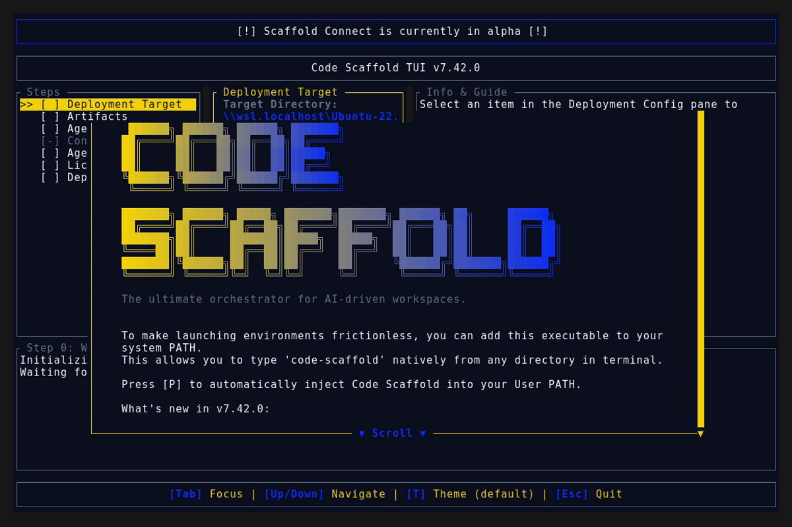
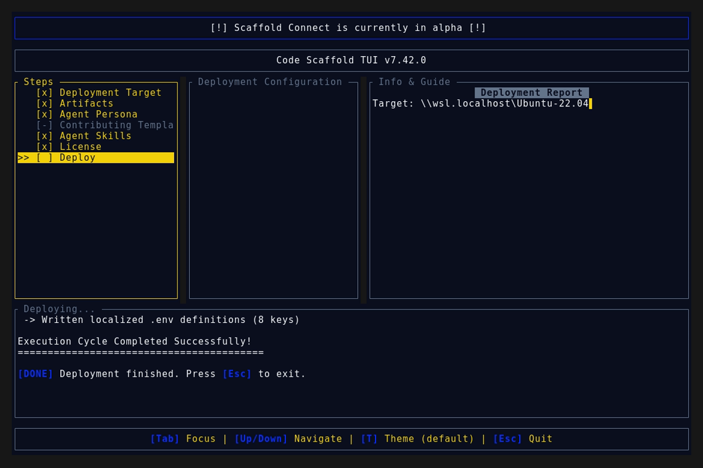
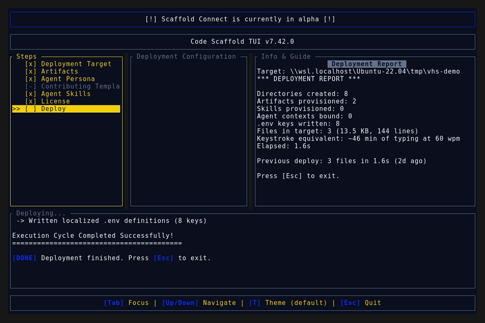

# Code Scaffold v7.42.0 Release Walkthrough

**Release Version:** `v7.42.0`

**Type:** Minor Release (+0.1.0)

**Date:** October 2026

## Overview
Code Scaffold `v7.42.0` introduces the **Artemis Mobile Automation** skill (`.skills/artemis`), bringing natural-language Android device control, multimodal Vision-Language Model (VLM) screen perception, and a native Model Context Protocol (MCP) server to the Code Scaffold ecosystem. This release bridges autonomous AI coding agents with real and emulated Android hardware, translating high-level conversational goals into resilient, self-healing UI workflows across smartphones, tablets, and foldables.

---

## Visual Demonstration

### Interactive TUI Visuals

---

## Key Features and Enhancements

### 1. Artemis Mobile Automation Skill (`.skills/artemis`)
* **Multimodal VLM Perception Engine**:
  * Unifies high-resolution visual screen captures with **UIAutomator XML** view hierarchies and **OCR bounding box grounding** to eliminate brittle coordinate-bound test scripts and selector rot.
  * Seamlessly navigates custom canvas rendering across Flutter, Jetpack Compose, React Native, and WebViews where standard accessibility tags are omitted.
  * Normalizes spatial coordinates `(0.0 <= x, y <= 1.0)` across varying device resolutions (1080x2400 phones, 1840x2208 foldables, 2560x1600 tablets).
* **Native Model Context Protocol (MCP) Server**:
  * Implements 5 foundational tools exposing physical device actuation to AI coding assistants:
    * `mobile_run_task`: Dispatches asynchronous natural-language goals to the device execution engine.
    * `mobile_manage_task`: Provides runtime lifecycle management to query status, pause, abort, or inject mid-flight guidance.
    * `mobile_get_device_state`: Captures real-time multimodal observations (base64 PNG, XML view hierarchy, OCR text grids).
    * `mobile_inspect_trace`: Retrieves forensic telemetry, step-by-step action history, and Logcat crash dumps.
    * `mobile_diagnose`: Automated environment doctor and self-healing engine verifying ADB, scrcpy, and USB debugging states.
* **Dual Execution Profiles**:
  * **Flash Profile (3-5s per step)**: Ultra-fast reactive loop with aggressive token compaction for linear regression tests and standard UI flows.
  * **Pro Profile (15-40s per step)**: Deep exploratory reasoning with multi-step markdown test plans, precondition assertions, and dynamic error recovery.
* **Interactive Visual Sandbox Studio**:
  * Dark-mode interactive dashboard at `.skills/artemis/sandbox/index.html` featuring:
    * Virtual smartphone device canvas with interactive touch actuation and ripple visualizer.
    * Live MCP Tool Dispatcher for testing all 5 tool schemas with simulated JSON payloads.
    * Spatial Element Inspector and UIAutomator XML tree visualizer.
    * Real-time Android Logcat terminal with fatal crash and ANR detection alerts.
    * Device health monitor with automated self-healing verification.

### 2. TUI Persona Integration
* Updated the `Mobile (iOS/And)` persona in `scaffold-tui/src/components/workspace.rs` to automatically pre-select `artemis` alongside `xcross` and `mobile-pwa`.

### 3. Registry Indexing & Discovery
* Registered `Artemis Mobile Automation` under `### AI, MCP & Developer Tools` in `.skills/README.md`.
* Provided complete distribution manifest `skill-manifest.json` with SHA256 integrity token supporting ad-hoc installation via `npx @code-scaffold/skills-cli add upioneer/artemis`.

---

## Verification and Compliance Summary

* **SkillForge Compliance:** All 69 skills in the registry pass `verify_skills.js` with zero errors.
* **Rust Code Hygiene:** `cargo fmt --check` exited with code 0, `cargo clippy` passed with 0 warnings, and `cargo test` passed all 55 unit tests.
* **Release Media Capture:** Automated headless VHS capture via WSL generated `demo.gif` and high-fidelity TUI snapshots against the `v7.42.0` binary.
* **Typographic Invariants:** Strictly zero en/em dashes and no hyphens used as punctuation across all documentation files.
