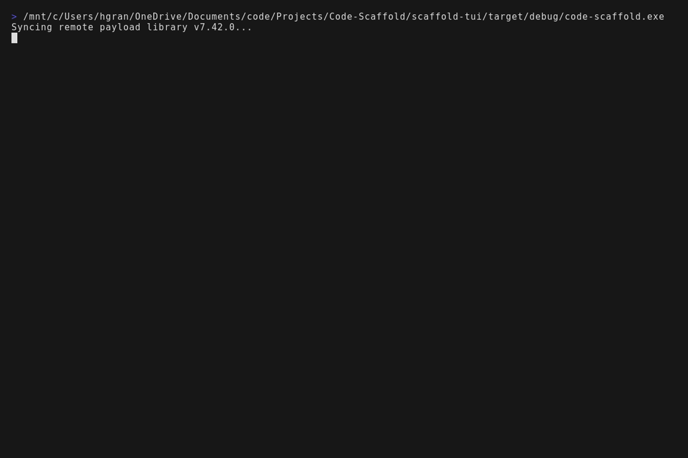
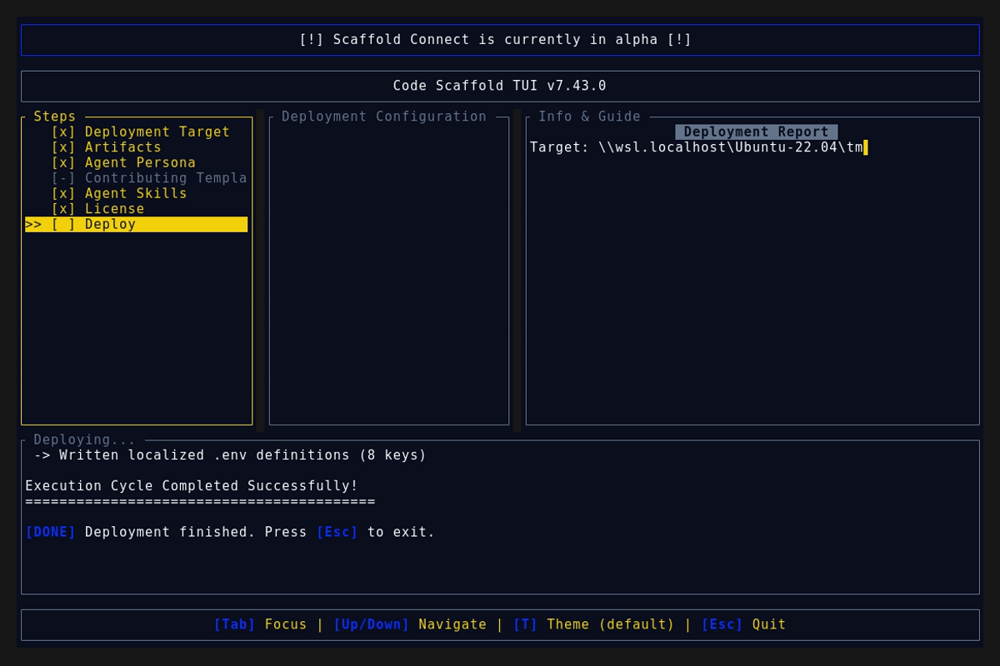
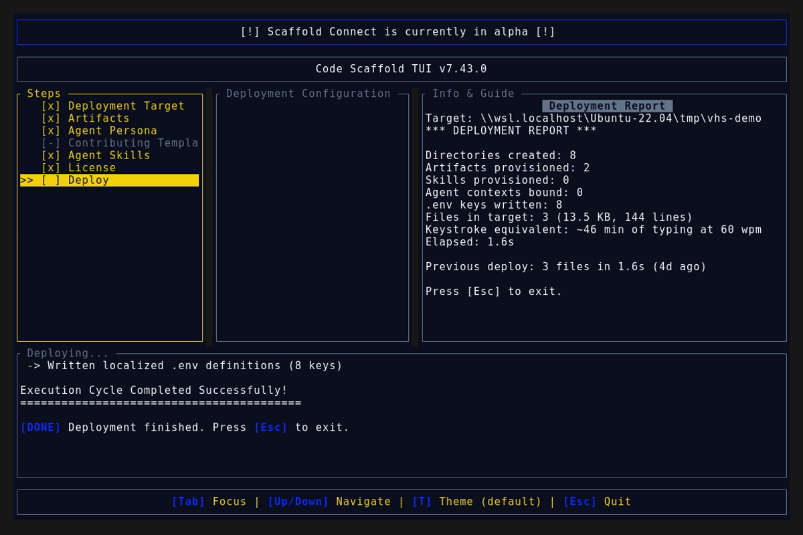

# Code Scaffold v7.43.0 Release Walkthrough

**Release Version:** `v7.43.0`

**Type:** Minor Release (+0.1.0)

**Date:** October 2026

## Overview
Code Scaffold `v7.43.0` introduces the **SkillForge Keyword Contract**, a single source of truth system that guarantees every skill carries consistent, website searchable discovery keywords in identical placement. The `skill-manifest.json` keywords array is now the only authoring surface, a new synchronizer regenerates every mirror deterministically, and the compliance gatekeeper enforces the contract with zero drift permitted. All 69 skills were trued up in this release.

---

## Visual Demonstration

### Interactive TUI Visuals

---

## Key Features and Enhancements

### 1. Keyword Contract Synchronizer (`project_details/playbooks/`)
* **Shared Contract Library** (`skill_keywords_lib.js`):
  * Defines the canonical rule set: 15 to 30 unique lowercase kebab-case terms with the skill slug first.
  * Provides parsers and renderers for every mirror surface: readme badges, SKILL.md frontmatter, and registry rows.
  * Used jointly by the synchronizer (writer) and the gatekeeper (verifier) so both sides can never disagree.
* **Deterministic Synchronizer** (`sync_skill_keywords.js`):
  * Regenerates the readme `**Keywords:**` badge, the SKILL.md frontmatter `keywords:` block list, the registry row preview plus version, and the root `manifest.json` entry from the manifest alone.
  * Ships a `--check` mode that reports drift and exits nonzero, suitable for CI gating.
  * Proven idempotent: repeated runs rewrite zero files once the tree is in sync.

### 2. Gatekeeper Enforcement (`verify_skills.js` invariants 8 and 9)
* **Invariant 8, Keyword Contract:** validates term count, casing, uniqueness, and slug first ordering, then asserts byte exact mirror equality across readme badge and frontmatter.
* **Invariant 9, Registry Integrity:** asserts every skill owns a registry row under its manifest category heading with version and first 5 preview in sync, asserts root `manifest.json` listing, and fails on orphan rows pointing at missing directories.

### 3. Full Ecosystem True Up
* All 69 skills migrated with +1 version bumps: normalized keyword lexicons, mirrored badges and frontmatter, refreshed registry rows, and recomputed integrity tokens.
* Root `manifest.json` completed so the distribution manager lists every skill.
* SkillForge `PROTOCOL.md` plus agent rules updated to document the contract workflow for all future skill work.

---

## Verification and Compliance Summary

* **Keyword Sync:** `sync_skill_keywords.js --check` reports zero drift across 69 skills.
* **SkillForge Compliance:** All 69 skills in the registry pass `verify_skills.js` with zero errors, including negative probe coverage proving the new invariants catch count, mirror, and preview violations.
* **Rust Code Hygiene:** `cargo fmt --check` exited with code 0, `cargo clippy` passed with 0 warnings, and `cargo test` passed all 55 unit tests.
* **Release Media Capture:** Automated headless VHS capture via WSL generated `demo.gif` and high fidelity TUI snapshots against the `v7.43.0` binary.
* **Typographic Invariants:** Strictly zero en/em dashes and no hyphens used as punctuation across all documentation files.
