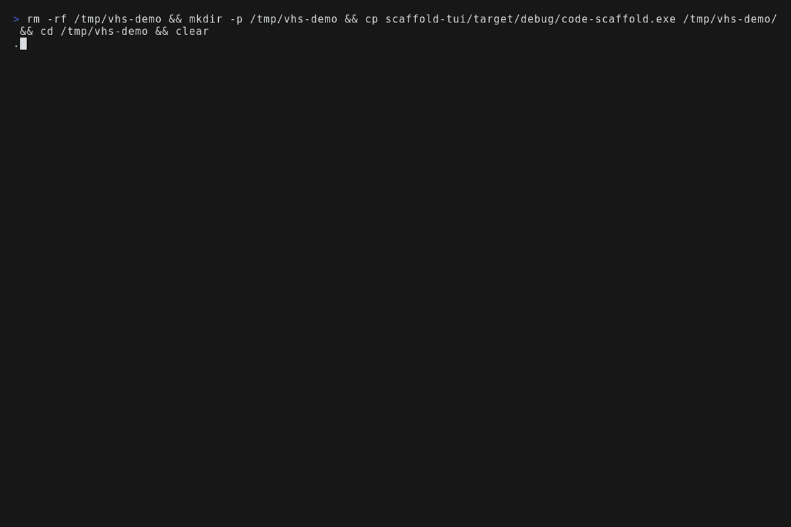
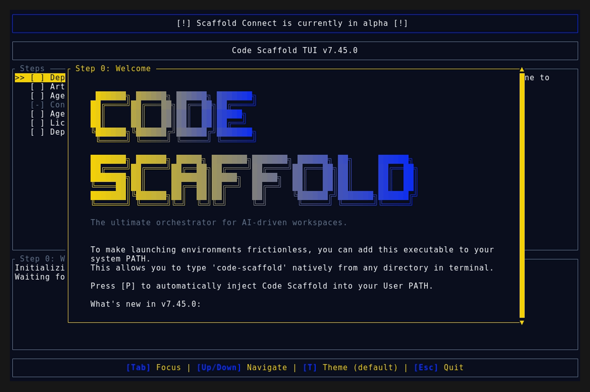
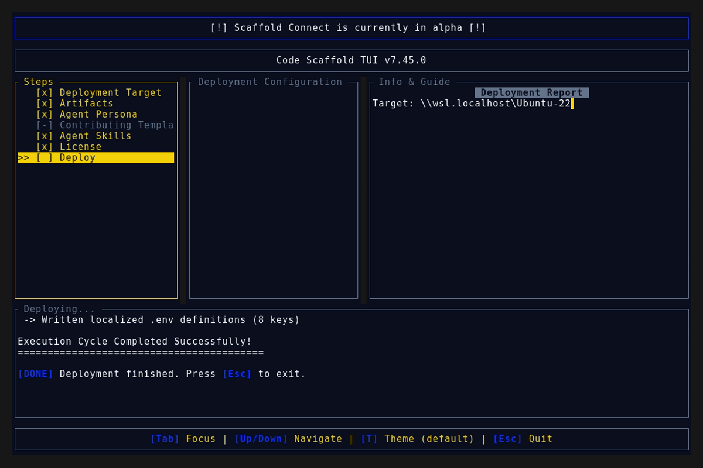
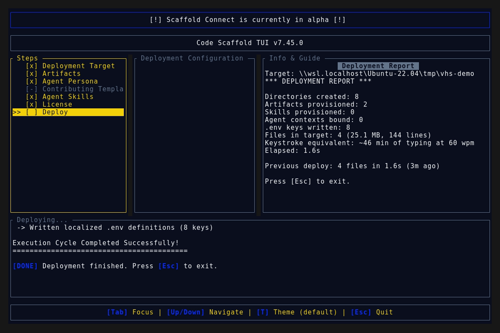

# Code Scaffold v7.45.0 Release Walkthrough

**Release Version:** `v7.45.0`

**Type:** Minor Release (+0.1.0)

**Date:** November 2026

## Overview
Code Scaffold `v7.45.0` ships the TV Hacking Arsenal v1, a new skill that roots, debloats, and reclaims smart TVs across Samsung Tizen, LG webOS, Android TV, Google TV, and Fire TV. This is a single feature release: one new skill plus release mechanics, bringing the library to 71 fully compliant skills.

---

## Visual Demonstration

### Interactive TUI Visuals

---

## Key Features and Enhancements

### 1. TV Hacking Arsenal v1: New Skill
* **Nine Guided TV Workflows**: scout first routing, Android TV plus Google TV debloat, Fire TV cleanup, LG webOS launcher paths with and without root, Samsung Tizen firmware research, remote control plus automation, privacy audits, and firmware update recovery.
* **LAN Debug Surface Scout** (`scripts/tv_scout.py`): probes ADB, SDB, webOS, Cast, and JointSpace ports and guesses the platform family so agents route correctly without guessing. Passes 10 built in self test assertions.
* **Tiered Reversible Debloat Planner** (`scripts/debloat_plan.py`): classifies package captures into safe, ask, review, and never tiers and emits matching disable plus restore scripts with a protected HOME guard. Passes 14 built in self test assertions.
* **Starter Package Tiers** (`data/package_tiers.json`): verified stock packages plus conservative name patterns, designed to extend from your own device capture.
* **Never Brick Safety Rails**: record first restore, small batches, updater consent gates, setup shadow wifi checks, debug hygiene close up, and LAN only exposure invariants.
* **Platform Atlas and Access Ladder**: five platform map plus six rung climb order so agents use the minimum access the goal needs.
* **Cross Skill Synergy**: Decipher for TV firmware analysis, Sentinel Strike plus CyberSecurity Toolkit for LAN posture, Artemis for Android verification flows, GhostImprint for capture provenance.

### 2. Release Discipline Note
* Tagging is restored as the default on every commit plus push, so field clients receive each skills payload through the normal tag driven update path with complete changelog coverage.

---

## Verification and Compliance Summary

* **Keyword Sync:** `sync_skill_keywords.js --check` reports zero drift across 71 skills.
* **SkillForge Compliance:** All 71 skills pass `verify_skills.js` with zero errors.
* **Rust Code Hygiene:** `cargo fmt --check` exits 0, `cargo clippy` passes with 0 warnings, and `cargo test` passes all 55 unit tests.
* **Release Media Capture:** Automated headless VHS capture via WSL generated `demo.gif` and high fidelity TUI snapshots against the `v7.45.0` binary, and a byte scan of every artifact confirms zero PII (no usernames, hostnames, or local paths).
* **Typographic Invariants:** Strictly zero en/em dashes and no hyphens used as punctuation across all documentation files.
