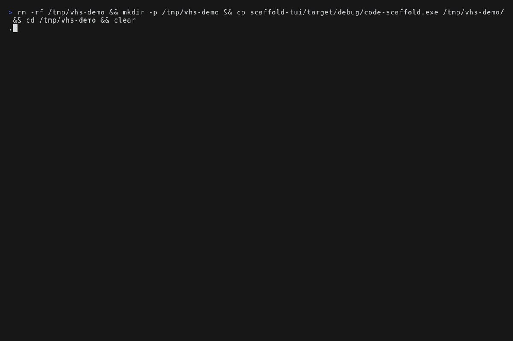
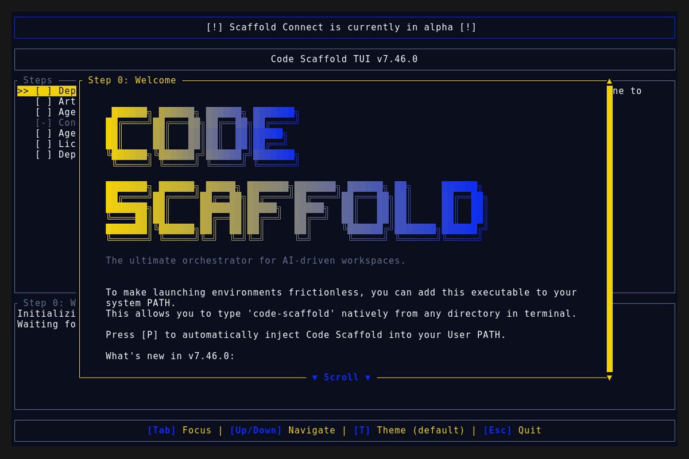
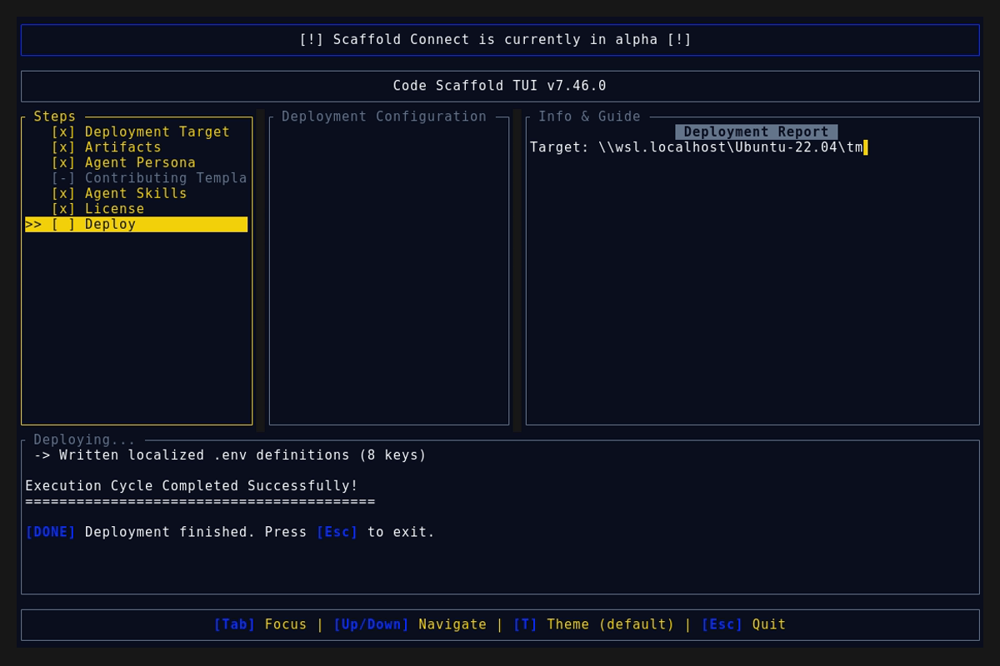
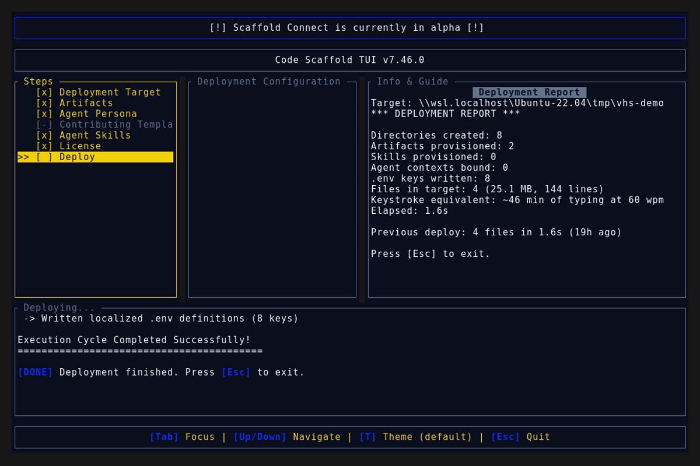

# Code Scaffold v7.46.0 Release Walkthrough

**Release Version:** `v7.46.0`

**Type:** Minor Release (+0.1.0)

**Date:** November 2026

## Overview
Code Scaffold `v7.46.0` ships two payloads: CAD Tools v14 with Pali Ijo plus PhysCAD support, and the brand new personas library with fifteen role packs. All 71 skills remain fully compliant with zero keyword drift.

---

## Visual Demonstration

### Interactive TUI Visuals

---

## Key Features and Enhancements

### 1. CAD Tools v14: Pali Ijo Plus PhysCAD
* **Pali Ijo Headless BREP Kernel** (Section 21): CLI command map, JSON pipeline discipline, selector guide, and documented limits with Dart SDK plus kernel commit pins. Live validated against a real engine build on Dart 3.13.7.
* **Pali Bridge** (`scripts/pali_bridge.py`): status, measure, export, and op chain run over a resolved engine path, with 16 built in self test assertions including CLI flag order regression coverage.
* **PhysCAD MCP Driven CAD/CAM** (Section 22): MCP control plane pattern, model plus draw plus machine agent workflows, interchange matrix, and maturity notes for the pre 1.0 licensed app.
* **Post Advisor** (`scripts/physcad_posts.py`): offline machine to post lookup across 17 mill, plasma, and laser families plus the open and export format matrix, with 11 built in self test assertions.
* **Keyword True Up**: swapped three narrow terms for `palicad`, `pali-ijo`, and `physcad` to hold the 30 term contract cap.

### 2. Personas Library v1: Fifteen Role Packs
* **New Top Level Library** (`personas/`): reverse-engineer, fitness-coach, travel-planner, personal-finance, teacher-tutor, resume-career-coach, chef-meal-planner, writer-editor, zoologist-wildlife, political-analyst, gardener-homesteader, genealogist, auction-flipper, wedding-planner, and network-infra-engineer.
* **Routing Frontmatter**: every persona declares auto selected skills with reasons (richest: reverse-engineer with 5, network-infra-engineer with 7) plus Role, Method, Workflow, and Guardrails behavior packs.
* **Gap Build Queue**: 54 uncovered needs consolidated into 7 suggested future bundles (Health and Kitchen, Money and Career, Travel and Events, Research and Records, Maker and Grower, Creator and Teaching, Security and Infra Depth).
* **Schema Plus Registry**: `SCHEMA.md` pins the format for future bundles and `README.md` indexes all fifteen personas.

---

## Verification and Compliance Summary

* **Keyword Sync:** `sync_skill_keywords.js --check` reports zero drift across 71 skills.
* **SkillForge Compliance:** All 71 skills pass `verify_skills.js` with zero errors.
* **Personas Validation:** All 15 persona files pass frontmatter, slug match, skill existence, and typography checks with zero errors.
* **Script Self Tests:** `pali_bridge.py` passes 16 of 16 and `physcad_posts.py` passes 11 of 11 offline assertions.
* **Live Engine Validation:** The Pali bridge was exercised against a real compiled `pali_ijo` engine (exact measure values, valid STEP export, working op chain); one CLI parsing defect found and fixed with regression coverage.
* **Rust Code Hygiene:** `cargo fmt --check` exits 0, `cargo clippy` passes with 0 warnings, and `cargo test` passes all 55 unit tests.
* **Release Media Capture:** Automated headless VHS capture via WSL generated `demo.gif` and high fidelity TUI snapshots against the `v7.46.0` binary; every frame was visually verified and a byte scan of every artifact confirms zero PII (no usernames, hostnames, or local paths).
* **Typographic Invariants:** Strictly zero en/em dashes and no hyphens used as punctuation across all documentation files.
