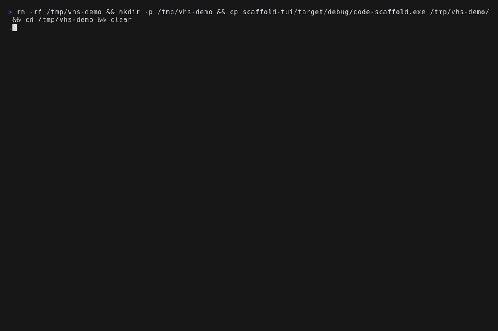
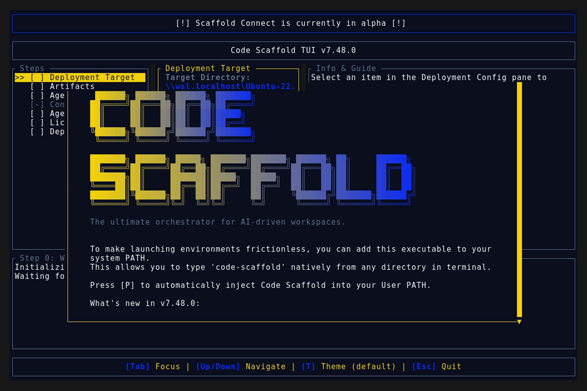
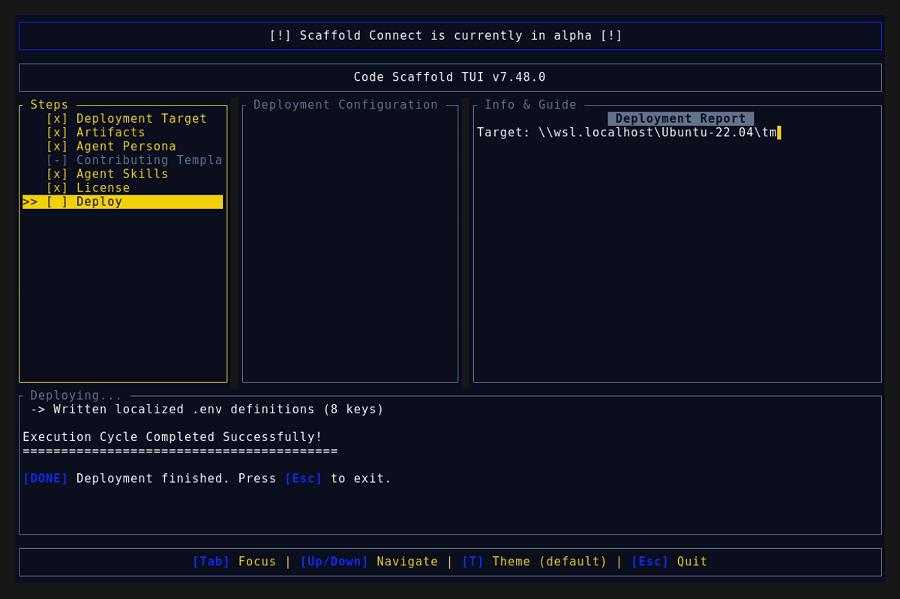
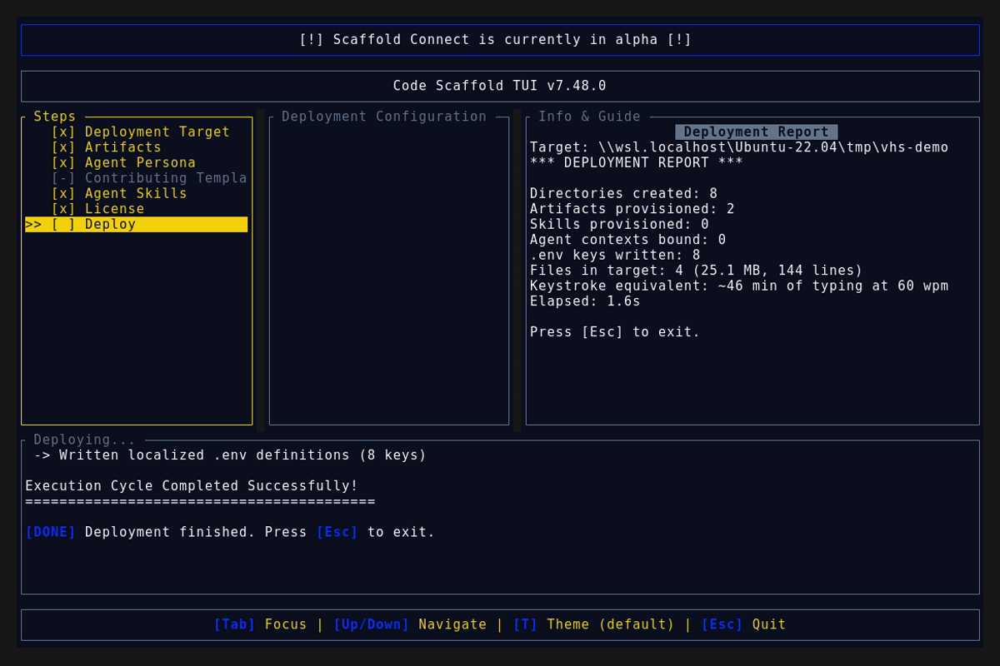
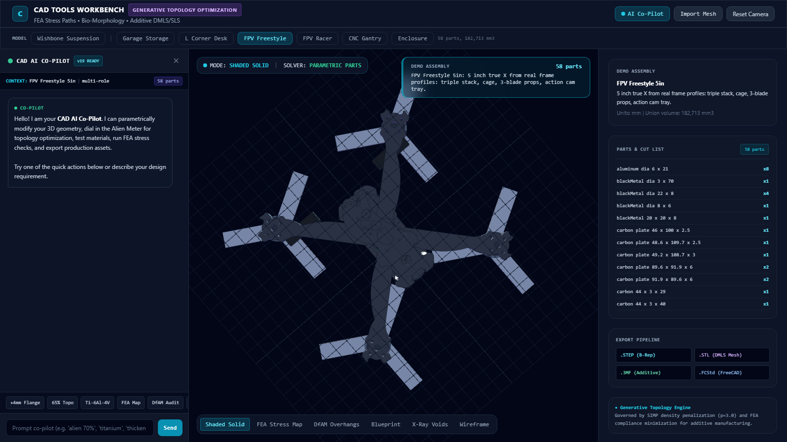
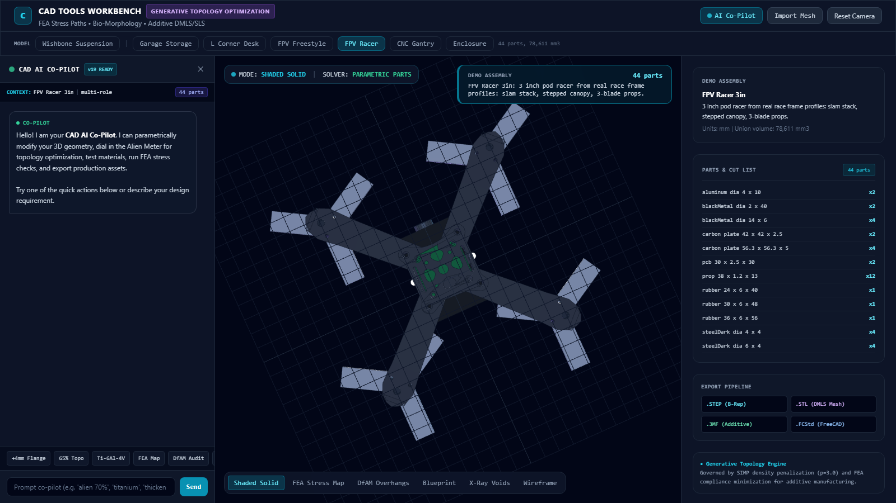
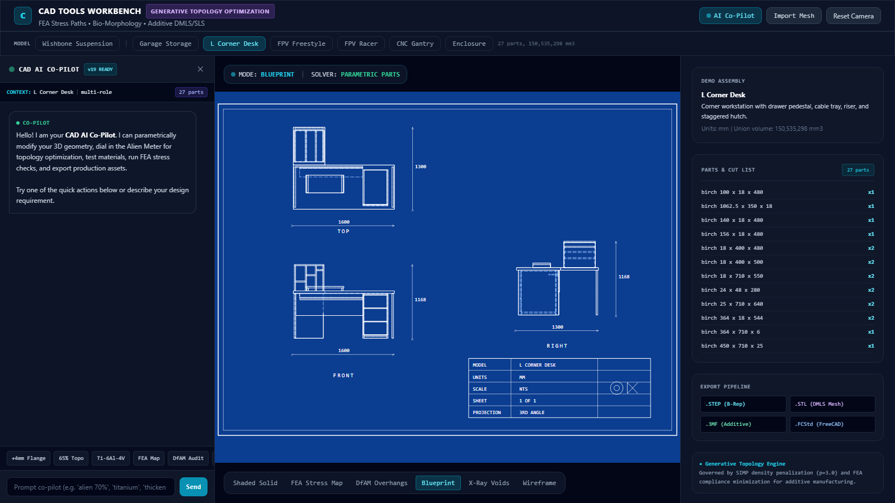

# Code Scaffold v7.48.0 Release Walkthrough

**Release Version:** `v7.48.0`

**Type:** Minor Release (+0.1.0)

**Date:** November 2026

## Overview
Code Scaffold `v7.48.0` ships CAD Tools v16 through v19: six parametric demo assemblies with a verified generator, an upgraded sandbox viewer with flat 2D blueprint sheets, and two FPV quads rebuilt from published open frame CAD profiles. This is a single skill improvement release with all 71 skills fully compliant and zero keyword drift.

---

## Visual Demonstration

### Interactive TUI Visuals

### CAD Sandbox Renders

---

## Key Features and Enhancements

### 1. Six Parametric Demo Assemblies (Section 25)
* **The Set**: complex garage storage wall (39 parts), L shape corner desk with divided hutch (27), 5 inch freestyle quad (58), 3 inch pod racer (44), benchtop CNC gantry (27), vented electronics enclosure (26); 221 parts total.
* **Generator Owned**: `scripts/demo_models.py` plus the `scripts/outlines.json` profile bank emit every artifact; hand editing `models/` or the viewer bundle is forbidden by regeneration rule.
* **Self Test**: 36 of 36 checks cover exact part counts, exact non overlap by separated axis testing, per part gravity support, material roles, and motor counts.

### 2. Sandbox Viewer Upgrades
* **Unified Model Bar**: one professional model switcher for the wishbone suspension hero plus all six demos; retired concept presets removed.
* **Flat 2D Blueprint Sheets**: third angle front, top, and right views with dashed hidden lines, true millimeter dimensions, and a title block with projection symbol.
* **Legends and Readability**: DfAM overhang plus FEA stress legends, lifted studio lighting for dark carbon, neutral underfill, phone responsive layout.

### 3. FPV Quads From Real Frame Profiles
* **Profiled Carbon**: plates with lightening holes traced from published open frame CAD, 6mm freestyle arms with clipped dovetail roots, stepped racer canopy.
* **Complete Aircraft**: 3 blade props on every motor, Z axis camera lenses, triple stack plus cage plus action cam tray on the freestyle, slam stack on the racer.
* **Corrected Orientation**: every arm root sandwiches under the body with every motor outboard; verified from top down renders.

### 4. Gravity Grounding Pass
* **Desk and Garage**: hinged doors, full width bay shelves, bridge cabinet sides, and divided hutch bays seat every previously floating part.
* **Permanent Check**: the generator self test now fails any part that is founded, resting, hung, or butt joined with insufficient contact.

---

## Verification and Compliance Summary

* **Keyword Sync:** `sync_skill_keywords.js --check` reports zero drift across 71 skills.
* **SkillForge Compliance:** All 71 skills pass `verify_skills.js` with zero errors.
* **Script Self Tests:** `demo_models.py` passes 36 of 36 offline assertions.
* **Rust Code Hygiene:** `cargo fmt --check` exits 0, `cargo clippy` passes with 0 warnings, and `cargo test` passes all 55 unit tests.
* **Release Media Capture:** Automated headless VHS capture via WSL generated `demo.gif` and high fidelity TUI snapshots against the `v7.48.0` binary; sandbox renders captured via headless browser; a byte scan of every artifact confirms zero PII (no usernames, hostnames, or local paths).
* **Visual Critic:** An independent screenshot review round returned READY on the final quad, grounding, blueprint, and phone evidence set.
* **Typographic Invariants:** Strictly zero en/em dashes and no hyphens used as punctuation across all documentation files.
