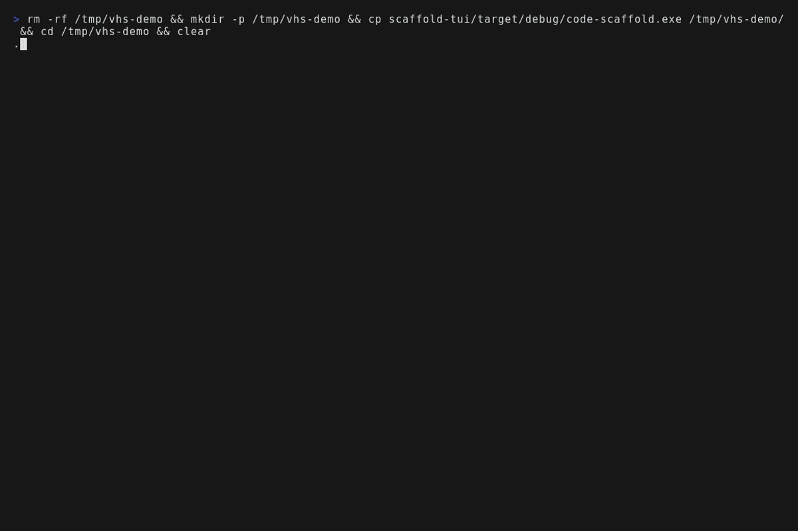
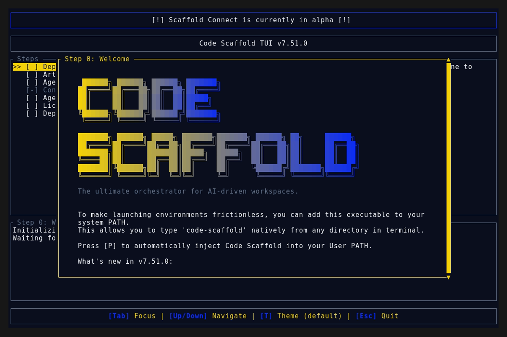
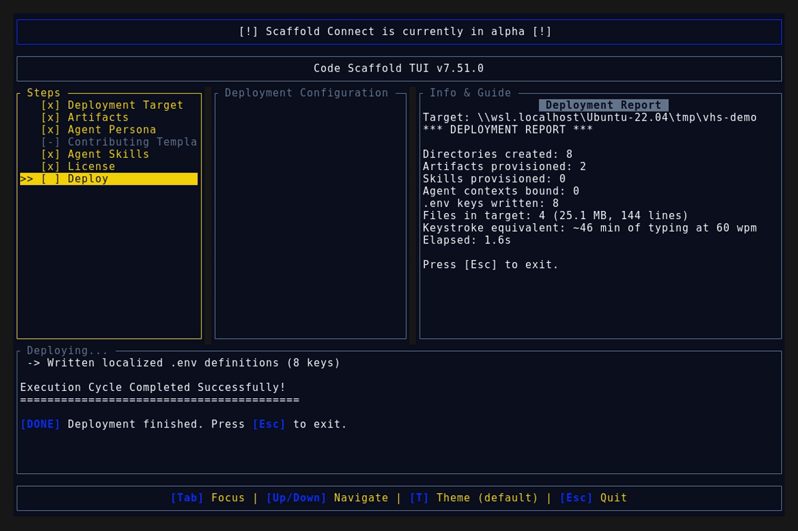

# Code Scaffold v7.51.0 Release Walkthrough

**Release Version:** `v7.51.0`

**Type:** Minor Release (+0.1.0)

**Date:** November 2026

## Overview
Code Scaffold `v7.51.0` ships the ComfyUI skill v1 for agent operated
generative pipelines plus an alphabetized persona picker that stays ordered
across versions. This release grows the library to 72 skills with zero
keyword drift and full SkillForge compliance.

---

## Visual Demonstration

### Interactive TUI Visuals

---

## Key Features and Enhancements

### 1. ComfyUI Skill v1
* **Operator Doctrine**: connection profiles, an eight step loop from
discovery to iteration, API format rules, and paid run consent.
* **References**: REST and WebSocket API, stable core node catalog, ten
runnable workflow skeletons, model families with VRAM tiers, and an
operations manual with troubleshooting matrix.
* **Tooling**: dependency free workflow validator with live server checks,
queue plus poll plus fetch client with input overrides, and a sample graph.
* **Sandbox**: interactive graph visualizer rendering any API workflow as a
layered node diagram with inline validation.

### 2. Alphabetized Persona Picker
* **Deterministic Order**: all 37 persona rows sort case insensitively at
build time so newly synced packs land in place version to version.
* **Locking Test**: a new test asserts picker order equals sorted order on
every run.

---

## Verification and Compliance Summary

* **Keyword Sync:** `sync_skill_keywords.js --check` reports zero drift across 72 skills.
* **SkillForge Compliance:** All 72 skills pass `verify_skills.js` with zero errors.
* **Rust Code Hygiene:** `cargo fmt --check` exits 0, `cargo clippy` passes with 0 warnings, and `cargo test` passes all 64 unit tests.
* **Release Media Capture:** Automated headless VHS capture via WSL generated `demo.gif` and high fidelity TUI snapshots against the `v7.51.0` binary; a byte scan of every artifact confirms zero PII (no usernames, hostnames, or local paths).
* **Typographic Invariants:** Strictly zero en/em dashes and no hyphens used as punctuation across all documentation files.
