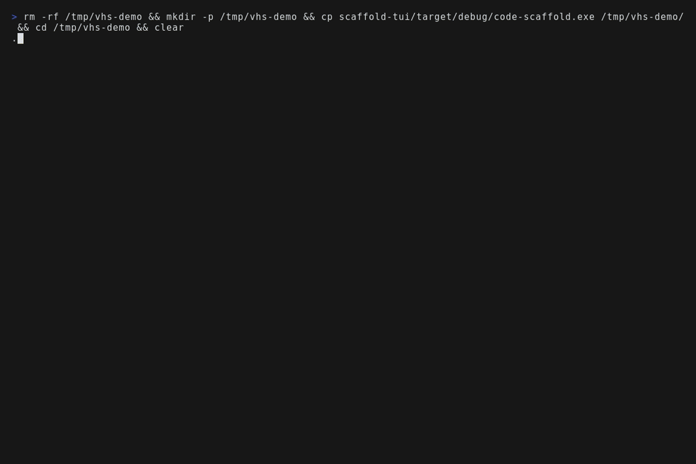
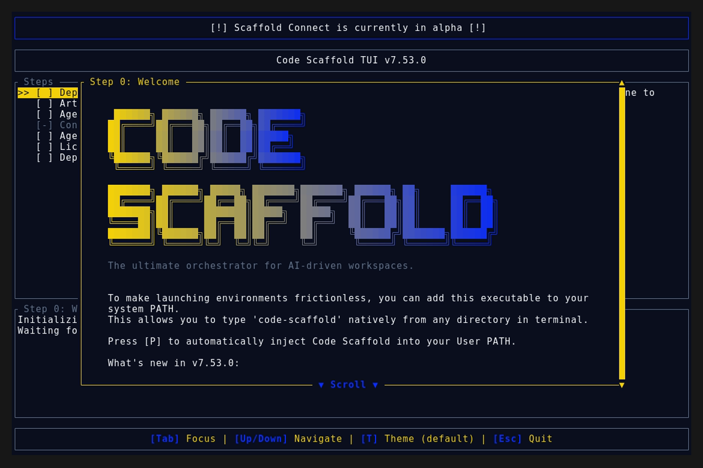
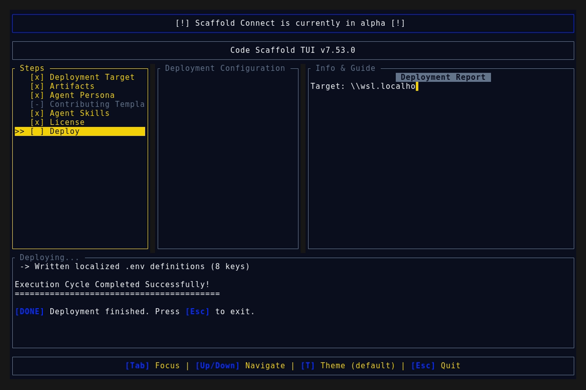
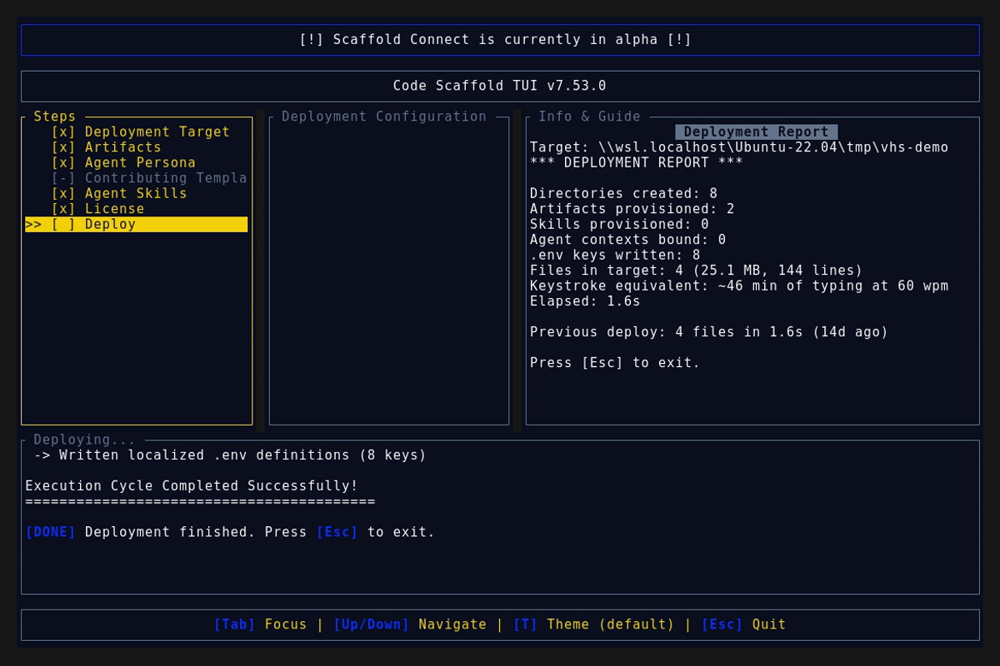

# Code Scaffold v7.53.0 Release Walkthrough

**Release Version:** `v7.53.0`

**Type:** Minor Release (+0.1.0)

**Date:** November 2026

## Overview
Code Scaffold `v7.53.0` introduces the flagship **AgentWire Multi-Surface Engine** skill (`.skills/agentwire`), enabling engineers to project a single typed Domain Capability Core simultaneously onto **MCP** (Model Context Protocol 2026-07-28 spec), **ACP** (Agent Client Protocol JSON-RPC 2.0), and **Telegram** (both Zero-AI deterministic bots with zero LLM keys and AI-powered streaming agents), plus an extensible `SurfaceAdapter` contract for future channels. This release also wires `agentwire` into the `AI Systems Engineer` persona, synchronizes all 75 skills under the SkillForge Keyword Contract, and updates workspace governance rules in `.agents/AGENTS.md`.

---

## Visual Demonstration

### Interactive TUI Visuals

---

## Key Features and Enhancements

### 1. AgentWire Multi-Surface Engine Skill (`.skills/agentwire`)
* **Single Domain Capability Core & Extensible Adapter Contract**:
  * Author typed schemas, risk tiers (`auto-allow`, `pocket-approve`, `deny`), idempotency keys, and streaming contracts once (`zod`, `pydantic`, `schemars`, or Go structs) with zero schema drift across MCP, ACP, and Telegram.
  * Decouples domain business logic behind a five-method `SurfaceAdapter` interface (`registerCapabilities`, `start`, `stop`, `onProgress`, `requestApproval`) so future channels (`A2A`, `Slack`, `Discord`, `Voice`) drop in cleanly without core rewrites.
* **Adaptive Scrutiny Dial & Codebase Opportunity Scanner**:
  * Prompts engineers upfront to select audit depth (*Tier 1 : Surgical Fast-Track*, *Tier 2 : Adaptive Repo Scan & Grill*, or *Tier 3 : Deep Adversarial Architect*) and Operating Mode (*Zero-AI Deterministic*, *Hybrid*, or *Full Agentic*).
  * Inspects routes, database schemas, background jobs, webhooks, CLIs, and dashboards to pitch three to five tailored unasked-for workflows grounded in real repository files before grilling on auth and blast radius.
* **Zero-AI Deterministic Telegram Pillar (`$0` LLM Cost)**:
  * Full production Telegram integration requiring zero AI API keys or token spend: typed `/command` routing, role-scoped BotFather menus (`setMyCommands`), schema-driven FSM multi-step form wizards with `[Back]`/`[Cancel]`, in-place paginated inline keyboards (`editMessageText`), `@bot` inline search queries, `t.me/Bot?start=link_<nonce>` 2FA/account linking, `retry_after` flood-safe cron/webhook alert digests, document/media import and export pipelines (`getFile`/`sendDocument`), native Telegram Stars (`XTR`) and fiat payments (`sendInvoice`), and pure-frontend Mini Apps (`initData` HMAC-SHA256 verified).
* **Modern MCP, ACP & Agentic Cross-Surface Bridges**:
  * **MCP (2026-07-28 Spec)**: Stateless Streamable HTTP (`Mcp-Method` / `Mcp-Name` headers, MRTR) plus `stdio`, Form-Mode and URL-Mode Elicitation, server Sampling, Async Tasks, and strict OAuth 2.1 (RFC 9728 metadata, PKCE S256, RFC 8707 `aud` binding, CIMD).
  * **ACP (JSON-RPC 2.0)**: `initialize`, `session/new` (auto-mounting the app's own MCP endpoint in `mcpServers[]`), `session/prompt`, `session/update`, and `session/request_permission` across Zed, JetBrains, Neovim, and Antigravity.
  * **Agentic Telegram & Pocket Gatekeeper**: Native `sendMessageDraft` token streaming, Forum Topic-per-Session multiplexing, Guest Mode (`@username`), Bot-to-Bot opt-in handoffs, Voice-to-Action, and HMAC-signed inline Pocket Approvals bridging IDE/ACP/MCP/CI pauses to mobile with fail-closed TTLs.
* **Polyglot Blueprints & Interactive Protocol & Wiring Studio**:
  * Complete new-app Surface-First and existing-app Strangler Sidecar starters for TypeScript, Python, Rust, and Go under `.skills/agentwire/references/`.
  * Offline-safe 4-tab Interactive Protocol & Wiring Studio at `.skills/agentwire/sandbox/index.html` showcasing live multi-surface projection, Zero-AI FSM Wizard + CI 2FA + ACP Pocket Gatekeeper simulations, Scrutiny Dial pitching, and security smoke tests.

### 2. TUI Persona, Registry & Governance Updates
* Wired `agentwire` into the `AI Systems Engineer` persona in `scaffold-tui/src/components/workspace.rs`.
* Registered `AgentWire Multi-Surface Engine` under `### AI, MCP & Developer Tools` in `.skills/README.md` and synchronized root `manifest.json` (`v7.53.0`).
* Updated `.agents/AGENTS.md` with the Pre-Commit Proof Sweep policy and Isolated Web Preview Server Lifecycle standard, and removed tracked scratch files from `project_details/proof/`.

---

## Verification and Compliance Summary

* **SkillForge Compliance:** All 75 skills in the registry pass `verify_skills.js` and `sync_skill_keywords.js --check` with zero errors.
* **Rust Code Hygiene:** Verified `cargo fmt --check`, `cargo clippy -- -D warnings`, and `cargo test` against `scaffold-tui` v7.53.0.
* **Release Media Capture:** Automated headless VHS capture via WSL generated `demo.gif` and high-fidelity TUI snapshots against the `v7.53.0` binary.
* **Typographic Invariants:** Strictly zero en/em dashes and no hyphens used as punctuation across all documentation files.
